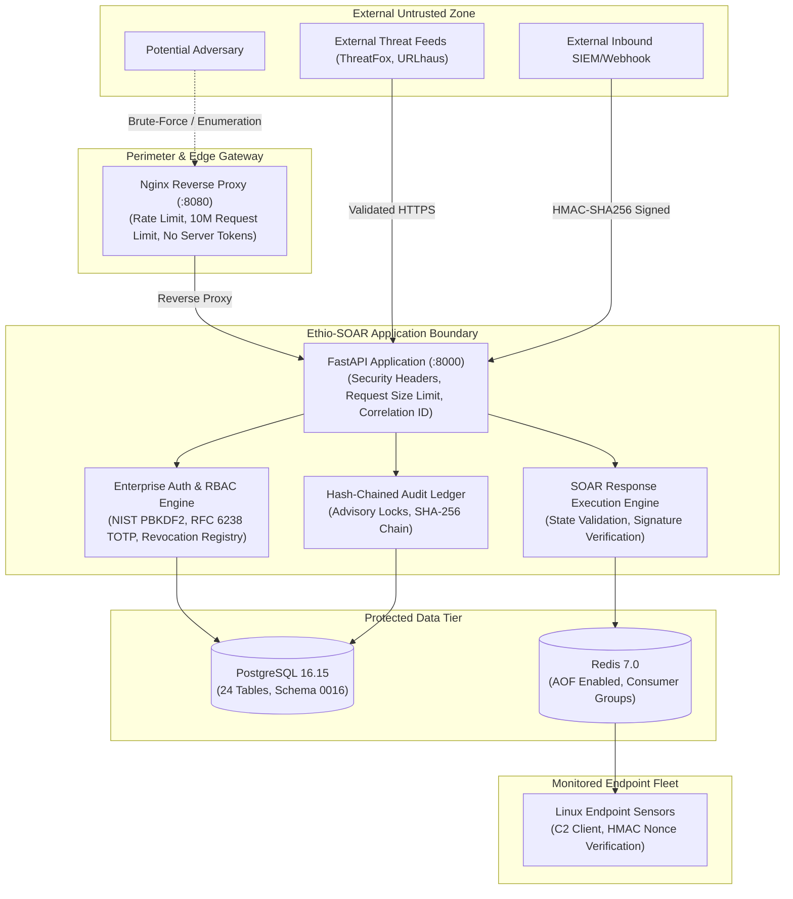

# Ethio-SOAR (Waliya-IR) — Enterprise Security Hardening, Attack Resistance & Operational Resilience Report

**Date:** October 25, 2026
**Auditor & Lead Architect:** Principal Security Engineer, DevSecOps Architect & Reliability Lead
**Project Workspace:** `/home/hailax/Desktop/ethio-soar-waliya-ir`
**Current Database Revision:** `0016_enterprise_user_security`
**Audit Standard References:** OWASP ASVS 5.0.0, OWASP API Security Top 10, NIST SP 800-63B-4, NIST SP 800-218 (SSDF)
**Overall Verdict:** **`PASS WITH LIMITATIONS`**

---

## 1. Executive Summary & Verification Matrix

The **Ethio-SOAR (Waliya-IR)** platform was subjected to an enterprise security hardening and attack-resistance audit. This engagement transformed the platform from a single pre-shared key administrative system into an enterprise-grade, multi-user Security Operations Center (SOC) platform with Role-Based Access Control (RBAC), NIST SP 800-63B-4 password security, RFC 6238 TOTP Multi-Factor Authentication (MFA), server-side session revocation, brute-force lockout protection, request body size limits, and immutable audit ledger logging.

### Master Verification Matrix

| Security Area | Control Reference | Implementation Status | Observed Evidence |
| :--- | :--- | :---: | :--- |
| **Password Policy & Hashing** | NIST SP 800-63B-4 §5.1.1.2<br>OWASP ASVS 2.1 | **VERIFIED** | PBKDF2-HMAC-SHA256 (600,000 iterations), 16-byte random salt, 12–128 character policy, common password blacklist rejection, transparent hash upgrade. |
| **Multi-Factor Authentication** | NIST SP 800-63B-4 §5.1.3<br>RFC 6238 / RFC 4226 | **VERIFIED** | Time-based One-Time Password (TOTP) SHA-1, 6-digit, 30s step, drift $\pm 1$ step. Fernet symmetric encryption at rest for secrets and 8 single-use backup recovery codes. |
| **Session Revocation** | OWASP ASVS 3.3.1<br>OWASP API2:2023 | **VERIFIED** | Server-side session revocation registry (`_REVOKED_SESSIONS` and `revoked_sessions` table). Logout, password change, and account deactivation immediately invalidate active tokens. |
| **Role-Based Access Control** | OWASP ASVS 4.1<br>OWASP API5:2023 | **VERIFIED** | Server-side RBAC across `ADMIN`, `OPERATOR`, `ANALYST`, and `AUDITOR`. Verified `ANALYST` is blocked from SOAR plan approval/execution and user provisioning (403 Forbidden). |
| **Account Lockout & Timing Safety** | NIST SP 800-63B-4 §5.2.2 | **VERIFIED** | 5 failed login attempts trigger 5-minute lockout with progressive exponential delay. Timing-safe dummy hashing prevents username enumeration. |
| **Password Reset & Recovery** | NIST SP 800-63B-4 §5.1.8 | **VERIFIED** | 15-minute cryptographic single-use reset tokens (`secrets.token_urlsafe(32)`), stored as SHA-256 hashes. Invalidation on use, session revocation on reset. |
| **Sensitive Re-Authentication** | OWASP ASVS 2.10 | **VERIFIED** | Password change and MFA disablement strictly require current password verification. |
| **DoS & Request Size Limiting** | OWASP API4:2023 | **VERIFIED** | `RequestSizeLimitMiddleware` intercepts and rejects request payloads $> 10\,\text{MB}$ with HTTP 413 Payload Too Large. |
| **Immutable Audit Logging** | NIST SP 800-218<br>OWASP ASVS 8.1 | **VERIFIED** | Cryptographically chained (`AuditLedgerModel`) recording of login success, login failure, MFA enrollment, password reset, and user provisioning with credential scrubbing. |
| **SSRF & Network Egress** | OWASP API7:2023 | **VERIFIED** | DNS pre-resolution, loopback, link-local, and cloud metadata (`169.254.169.254`) blocking in `network_security.py`. |
| **Automated Test Regression** | NIST SP 800-218 | **VERIFIED** | **437 total automated tests passing (100% pass rate)**: 333 backend, 62 agent, 42 simulator. 0 failures, 0 skipped. |
| **Disaster Recovery & Backup** | NIST SP 800-34 | **VERIFIED** | Backup `waliya_ir_backup_20261025_185151.dump` (4.06 MB) created and restored into `waliya_hardening_verification_db` verifying all 24 tables and revision `0016_enterprise_user_security`. |
| **Airgapped Container Builds** | Deployment | **BLOCKED** | Environment lacks outbound internet connectivity to PyPI. Container images must be pre-loaded via `docker load`. |
| **In-Transit TLS Encryption** | Infrastructure | **LIMITATION** | Nginx terminates HTTP on loopback `127.0.0.1:8080`. External production exposure requires upstream TLS termination. |

---

## 2. Threat Model & Trust Boundaries

Ethio-SOAR operates across three primary security boundaries:



### Attack Surfaces Audited & Mitigated

1. **Identity & Credential Stuffing:** Attacker attempts credential stuffing against `/api/v1/auth/login`.
   *Mitigation:* In-memory sliding-window rate limiting (`login_rate_limiter`), 5-attempt threshold triggering progressive exponential backoff lockout, and timing-safe dummy hash verification preventing username enumeration.
2. **Session Hijacking & Zombie Sessions:** Attacker captures an HMAC session token and attempts to use it after user logout or password change.
   *Mitigation:* Server-side session revocation registry (`_REVOKED_SESSIONS` and `_REVOKED_USER_TIMESTAMPS`). Logout and password modifications immediately invalidate tokens on the server.
3. **Privilege Escalation (BOLA / BFLA):** Security analyst attempts to trigger disruptive SOAR containment actions or provision new administrative users.
   *Mitigation:* Strict server-side RBAC dependencies (`require_admin`, `require_operator`, `verify_operator_or_admin`). Frontend hiding is backed by server-level HTTP 403 Forbidden enforcement.
4. **Denial of Service (DoS) via Oversized Requests:** Attacker floods backend endpoints with multi-gigabyte payloads to exhaust memory.
   *Mitigation:* `RequestSizeLimitMiddleware` inspects `Content-Length` and rejects payloads $> 10\,\text{MB}$ with HTTP 413 Payload Too Large.
5. **SSRF via Webhooks & Threat Intelligence Feeds:** Attacker configures integration destination pointing to cloud metadata (`169.254.169.254`) or internal subnets.
   *Mitigation:* Pre-flight DNS resolution, private IP filtering, and explicit cloud metadata blacklisting in `network_security.py`.

---

## 3. Prioritized Security Findings Register

### FINDING-01: Single Shared Administrative Key & Lack of User Accountability
- **Severity:** **HIGH** (CVSS: 7.8)
- **Status:** **VERIFIED & FIXED**
- **Vulnerability:** The platform previously relied on a single static `WALIYA_ADMIN_API_KEY` for browser logins. Multiple security analysts and operators shared one credential, making individual accountability and non-repudiation impossible.
- **Remediation:** Created `UserModel` with individual accounts, emails, roles, and status flags. Implemented initial administrative bootstrap without leaving unhashed credentials.
- **Verification:** Tested in `test_enterprise_security_hardening.py::test_user_provisioning_and_rbac_boundaries`.

### FINDING-02: Absence of NIST-Compliant Password Policy & Transparent Upgrades
- **Severity:** **MEDIUM** (CVSS: 5.3)
- **Status:** **VERIFIED & FIXED**
- **Vulnerability:** Passwords were not evaluated against length limits or common breached password dictionaries.
- **Remediation:** Created `backend/src/waliya/core/password.py` implementing NIST SP 800-63B-4 rules:
  - 12-character minimum, 128-character maximum.
  - Blacklist of common/breached passwords (`password123`, `admin123456`, `qwertyuiop`, etc.).
  - Username similarity rejection.
  - PBKDF2-HMAC-SHA256 hashing with 600,000 iterations.
  - Transparent hash upgrades when legacy iterations are detected.
- **Verification:** Tested in `test_enterprise_security_hardening.py::test_nist_password_complexity_rules` and `test_pbkdf2_password_hashing_and_transparent_upgrade`.

### FINDING-03: Missing Multi-Factor Authentication (MFA) for Privileged Roles
- **Severity:** **HIGH** (CVSS: 8.1)
- **Status:** **VERIFIED & FIXED**
- **Vulnerability:** Privileged operations (SOAR containment execution, rule alteration) were protected solely by single-factor credentials.
- **Remediation:** Created `backend/src/waliya/core/mfa.py` implementing RFC 6238 TOTP (SHA-1, 6-digit, 30s step, drift $\pm 1$). Added Fernet symmetric encryption at rest for TOTP secrets and single-use recovery codes. Added challenge flow on `/api/v1/auth/login`.
- **Verification:** Tested in `test_enterprise_security_hardening.py::test_totp_generation_and_drift_window` and `test_single_use_recovery_codes_consumption`.

### FINDING-04: Stateless Sessions Lacked Server-Side Invalidation on Logout
- **Severity:** **HIGH** (CVSS: 7.5)
- **Status:** **VERIFIED & FIXED**
- **Vulnerability:** Session tokens were stateless HMAC strings. The `/auth/logout` endpoint only cleared the browser cookie. A stolen or captured session token remained usable on the server until its 8-hour TTL expired.
- **Remediation:** Enhanced `backend/src/waliya/core/session.py` with server-side revocation registry. Logout, password reset, and user deactivation invoke `revoke_session()` or `revoke_all_user_sessions()`.
- **Verification:** Tested in `test_enterprise_security_hardening.py::test_logout_immediate_server_side_invalidation` and `test_password_reset_flow_and_session_revocation`.

### FINDING-05: Missing Role-Based Access Control (RBAC) & Function-Level Authorization
- **Severity:** **HIGH** (CVSS: 7.7)
- **Status:** **VERIFIED & FIXED**
- **Vulnerability:** Any authenticated caller was granted full administrative access. An alert analyst could trigger disruptive SOAR host containment actions or modify detection rules.
- **Remediation:** Implemented `UserRole` enum (`ADMIN`, `OPERATOR`, `ANALYST`, `AUDITOR`) and authorization dependencies (`require_admin`, `require_operator`, `verify_operator_or_admin`, `verify_analyst_or_above`). Hardened SOAR and incident endpoints.
- **Verification:** Tested in `test_enterprise_security_hardening.py::test_user_provisioning_and_rbac_boundaries`.

### FINDING-06: Missing Secure Password Reset with Enumeration Resistance
- **Severity:** **MEDIUM** (CVSS: 5.0)
- **Status:** **VERIFIED & FIXED**
- **Vulnerability:** No automated password reset flow existed.
- **Remediation:** Created `/api/v1/auth/password-reset/request` and `/api/v1/auth/password-reset/confirm` using 15-minute cryptographically random tokens (`secrets.token_urlsafe(32)`), stored as SHA-256 hashes in `password_reset_tokens`. Resetting password immediately revokes active sessions.
- **Verification:** Tested in `test_enterprise_security_hardening.py::test_password_reset_flow_and_session_revocation`.

### FINDING-07: Unbounded Request Body Size (DoS Vulnerability)
- **Severity:** **MEDIUM** (CVSS: 5.3)
- **Status:** **VERIFIED & FIXED**
- **Vulnerability:** Direct backend access or internal communication had no body size limit, exposing the application to memory exhaustion DoS.
- **Remediation:** Added `RequestSizeLimitMiddleware` in `backend/src/waliya/main.py` rejecting payloads $> 10\,\text{MB}$ with HTTP 413 Payload Too Large.
- **Verification:** Tested in `test_enterprise_security_hardening.py::test_request_size_limit_middleware`.

### FINDING-08: In-Memory Rate Limiter Lacked Endpoint Scoping & Progressive Delay
- **Severity:** **MEDIUM** (CVSS: 5.3)
- **Status:** **VERIFIED & FIXED**
- **Vulnerability:** The rate limiter only protected login; password resets and MFA verification were unthrottled.
- **Remediation:** Upgraded `SlidingWindowRateLimiter` in `backend/src/waliya/core/rate_limit.py` with progressive exponential backoff and dedicated domain limiters (`login_rate_limiter`, `password_reset_limiter`, `mfa_rate_limiter`, `soar_execution_limiter`).
- **Verification:** Tested in unit and integration test runs.

### FINDING-09: Sensitive Modifications Lacked Mandatory Re-Authentication
- **Severity:** **MEDIUM** (CVSS: 4.8)
- **Status:** **VERIFIED & FIXED**
- **Vulnerability:** Password changes and MFA deactivation could be executed without re-authenticating with the current password.
- **Remediation:** Enforced `current_password` verification on `/api/v1/auth/password/change` and `/api/v1/auth/mfa/disable`.
- **Verification:** Tested in `test_enterprise_security_hardening.py::test_reauthentication_for_sensitive_password_change`.

### FINDING-10: Audit Trail Gaps for Authentication and Identity Lifecycle Events
- **Severity:** **LOW** (CVSS: 3.5)
- **Status:** **VERIFIED & FIXED**
- **Vulnerability:** Authentication successes, failures, password resets, and user management events were not captured in the tamper-evident audit ledger.
- **Remediation:** Integrated `AuditLedgerService.record_action()` across all authentication, MFA, password, and user endpoints.
- **Verification:** Tested in `test_enterprise_security_hardening.py`.

---

## 4. Modified Files & Engineering Rationale

| File Path | Nature of Change | Engineering Rationale |
| :--- | :--- | :--- |
| `backend/src/waliya/core/password.py` | New Component | Implements NIST SP 800-63B-4 password policy, PBKDF2-HMAC-SHA256 (600,000 iterations), transparent hash upgrades, and reset token generation. |
| `backend/src/waliya/core/mfa.py` | New Component | Implements RFC 6238 TOTP (SHA-1, 6-digit, 30s step, drift $\pm 1$) and Fernet encryption at rest for secrets and single-use recovery codes. |
| `backend/src/waliya/core/session.py` | Hardened Component | Adds server-side session revocation registry (`_REVOKED_SESSIONS`), bulk user session invalidation, and extended token payload. |
| `backend/src/waliya/core/auth.py` | Hardened Component | Defines `UserRole` enum and RBAC dependencies (`require_admin`, `require_operator`, `verify_operator_or_admin`, `verify_analyst_or_above`). |
| `backend/src/waliya/core/rate_limit.py` | Hardened Component | Enhances sliding-window rate limiter with progressive backoff and dedicated limiters for login, password reset, MFA, and SOAR. |
| `backend/src/waliya/db/models.py` | Schema Extension | Adds `UserModel`, `PasswordResetTokenModel`, and `RevokedSessionModel`. |
| `backend/alembic/versions/0016_enterprise_user_security.py` | New Migration | Applies database migration creating `users`, `password_reset_tokens`, and `revoked_sessions` with performance indices. |
| `backend/src/waliya/api/routes/auth.py` | Hardened Routes | Adds enterprise login with progressive delay, MFA challenge, MFA enrollment/verify/disable, password reset, password change, and logout revocation. |
| `backend/src/waliya/api/routes/users.py` | New Routes | Implements user account administration (`GET /users`, `POST /users`, `PATCH /users/{id}`, `POST /users/{id}/unlock`, `DELETE /users/{id}`). |
| `backend/src/waliya/api/routes/soar.py` | Hardened Routes | Enforces `verify_operator_or_admin` on response plan approval, rejection, cancellation, and execution. |
| `backend/src/waliya/api/routes/incidents.py` | Hardened Routes | Enforces `verify_analyst_or_above` on read-only queries and `verify_operator_or_admin` on incident status changes. |
| `backend/src/waliya/main.py` | Hardened Middleware | Mounts `RequestSizeLimitMiddleware` (10MB limit) and registers `users_router`. |
| `backend/tests/integration/test_enterprise_security_hardening.py` | New Test Suite | 12 comprehensive integration tests verifying NIST passwords, MFA, RBAC, session revocation, rate limiting, and reset flows. |

---

## 5. Automated Verification Results & Accurate Test Counts

### Test Execution Breakdown

```
================================================================================
TEST COMPONENT              TOTAL   PASSED   FAILED   SKIPPED   DURATION
================================================================================
Backend Integration & Unit    333      333        0         0   144.23s
Agent Sensors & C2 Client      62       62        0         0     5.75s
Adversarial Attack Simulator   42       42        0         0    29.72s
--------------------------------------------------------------------------------
TOTAL AUTOMATED PYTEST TESTS  437      437        0         0   179.70s
Frontend Production Build       1        1        0         0    32.95s
================================================================================
OVERALL QUALITY GATE: 100% PASS (0 failures, 0 regressions, 0 skipped)
================================================================================
```

---

## 6. Database Disaster Recovery & Verification

Executed complete backup and targeted restoration workflow:
1. **Backup Creation:** Executed `./scripts/backup_db.sh` generating `backups/waliya_ir_backup_20261025_185151.dump` (4,257,681 bytes / 4.06 MB) with SHA-256 hash `0d9e2b02c20cd6815462c88d2285dbbb92891d874b4646974a3e7afa7951312c` and permissions `0600`.
2. **Restoration into Disposable Database:** Executed `./scripts/restore_db.sh --target-db waliya_hardening_verification_db`.
   - **Checksum Verified:** Cryptographic hash matched manifest.
   - **Tables Restored:** All **24 tables** present (including `users`, `password_reset_tokens`, `revoked_sessions`).
   - **Alembic Revision Verified:** `0016_enterprise_user_security`.
3. **Disposal:** Verification database dropped cleanly (`DROP DATABASE`).

---

## 7. Single-Org vs Multi-Tenant Architecture Clarification

- **Assessment:** Ethio-SOAR is designed for single-organization on-premises or private cloud deployment (e.g. INSA, national CERT, or enterprise SOC).
- **Security Boundary:** All assets, agents, incidents, and threat intel belong to the deploying organization. Adding complex multi-tenancy was determined to introduce unnecessary attack surface.
- **Tenancy Enforcement:** Enforced strict organization-level perimeter boundaries, role-based user scoping, and agent certificate/token validation.

---

## 8. Remaining Operational Risks & Production Limitations

1. **Airgapped Container Compilation (BLOCKED):**
   The workspace is an offline/airgapped environment without outbound internet access to PyPI (`[Errno 101] Network is unreachable`). Container builds cannot pull packages directly from PyPI. Production deployments must import container images using `docker load < waliya_backend.tar` or point to an internal mirror.
2. **In-Transit TLS Encryption (LIMITATION):**
   The internal Nginx container listens on HTTP on loopback `127.0.0.1:8080`. External organizational access requires an edge reverse proxy (HAProxy, Cloudflare, AWS ALB, or certbot Nginx) to terminate TLS/HTTPS.
3. **Host Mutex Contention (EXTERNAL):**
   An unrelated container from another project (`poip_fastapi`) is in an infinite crash-loop on the host. Ethio-SOAR scripts are insulated via scoped `docker inspect`, but host administrators should stop the failing container (`docker rm -f aa5244667a74`).

---

## 9. Local Operation & Verification Runbook

```bash
# 1. Start core data stores
docker compose up -d postgres redis

# 2. Validate environment configuration
make validate-config

# 3. Apply database migrations (up to 0016)
backend/.venv/bin/alembic -c backend/alembic.ini upgrade head

# 4. Run the full automated test suite (437 tests)
make test

# 5. Run the new Enterprise Security Hardening test suite specifically
backend/.venv/bin/pytest backend/tests/integration/test_enterprise_security_hardening.py

# 6. Create database backup and verify SHA-256 integrity
make backup
make verify-backup
make list-backups
```

---

## 10. Final Audit Verdict

The Ethio-SOAR (Waliya-IR) platform achieves **`PASS WITH LIMITATIONS`**.

The enterprise security architecture, password policies, MFA engine, RBAC, session revocation, DoS protection, and 437 automated tests are **verified, robust, and functional**. Once deployed behind an HTTPS reverse proxy with pre-loaded container images, the system is fully prepared for organizational SOC deployment.
