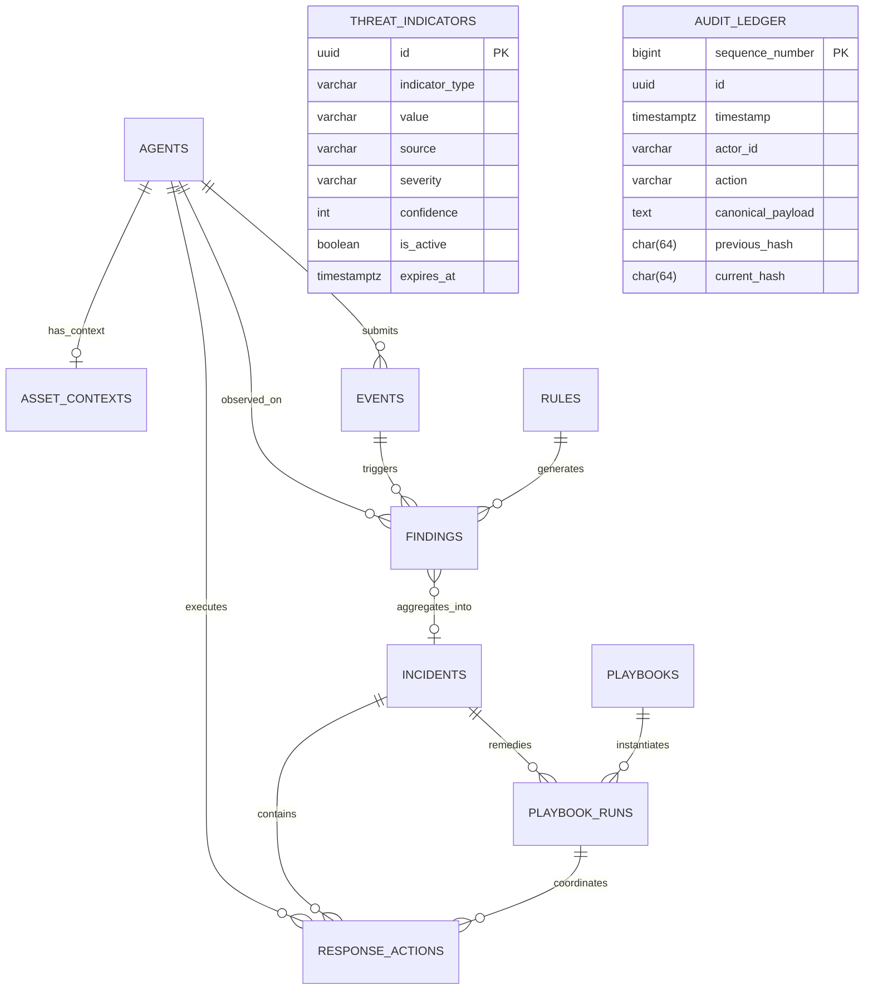

# Relational Database Schema & Data Model
**Project:** Ethio-SOAR (Waliya-IR)
**Database Engine:** PostgreSQL 18
**ORM:** SQLAlchemy 2.0 (Async) + Alembic
**Status:** Locked / Approved (Phase 1 — Step 2)

---

## 1. Entity-Relationship Overview

---

## 2. Relational Table Specifications

### 2.1 `agents`
Represents registered endpoint sensors in the environment.
- `id` (UUID, Primary Key): Unique agent identifier.
- `hostname` (VARCHAR(255), Indexed): Hostname of the endpoint.
- `os_family` (VARCHAR(64)): Linux distribution family (e.g., `ubuntu`, `rhel`, `debian`).
- `os_version` (VARCHAR(128)): Kernel & distribution release version.
- `primary_ip` (INET / VARCHAR(45)): Primary network interface IP address.
- `mac_address` (VARCHAR(32)): Primary MAC address.
- `status` (VARCHAR(32), Default `'ONLINE'`): Status enum (`ONLINE`, `DEGRADED`, `OFFLINE`, `REVOKED`).
- `api_token_hash` (VARCHAR(128), Unique): SHA-256 hash of the agent's REST API bearer token.
- `secret_key_enc` (BYTEA / TEXT): Encrypted agent secret for HMAC-SHA256 signature verification.
- `last_heartbeat` (TIMESTAMPTZ, Indexed): Last observed heartbeat timestamp.
- `registered_at` (TIMESTAMPTZ, Default `NOW()`): Timestamp of agent enrollment.

### 2.2 `events`
Raw and normalized security telemetry emitted by agents or third-party feeds.
- `id` (UUID, Primary Key): Event identifier.
- `agent_id` (UUID, Foreign Key `agents.id`, Nullable, Indexed): Associated endpoint.
- `event_type` (VARCHAR(64), Indexed): E.g., `FILE_INTEGRITY`, `PROCESS_EXECUTION`, `AUTHENTICATION`, `NETWORK_CONNECTION`.
- `severity` (VARCHAR(32), Indexed): `INFORMATIONAL`, `LOW`, `MEDIUM`, `HIGH`, `CRITICAL`.
- `timestamp` (TIMESTAMPTZ, Indexed): Observation timestamp.
- `raw_payload` (JSONB): Preserved unparsed raw input.
- `normalized_payload` (JSONB, Indexed with GIN): Validated, standardized semantic attributes.

### 2.3 `rules`
Versioned security detection rules.
- `id` (UUID, Primary Key): Rule internal ID.
- `rule_id` (VARCHAR(64), Unique, Indexed): Stable identifier (e.g., `RULE-FIM-004`).
- `version` (INTEGER, Default 1): Incremental rule version.
- `name` (VARCHAR(255)): Human-readable rule title.
- `description` (TEXT): Rule explanation and threat description.
- `severity` (VARCHAR(32)): Rule severity rating.
- `conditions` (JSONB): Structured AST logic conditions.
- `mitre_attack_ids` (JSONB): List of MITRE ATT&CK technique IDs (e.g. `["T1059.004"]`).
- `dedup_window_seconds` (INTEGER, Default 300): Suppression window for identical alert keys.
- `is_active` (BOOLEAN, Default TRUE): Enable/disable toggle.
- `created_at` (TIMESTAMPTZ, Default `NOW()`): Creation timestamp.
- `updated_at` (TIMESTAMPTZ, Default `NOW()`): Modification timestamp.

### 2.4 `findings`
Individual alert matches produced by detection rules or behavioral analytics.
- `id` (UUID, Primary Key): Finding identifier.
- `rule_id` (UUID, Foreign Key `rules.id`, Nullable): Matching detection rule.
- `event_id` (UUID, Foreign Key `events.id`): Originating event.
- `agent_id` (UUID, Foreign Key `agents.id`, Nullable): Associated agent.
- `incident_id` (UUID, Foreign Key `incidents.id`, Nullable, Indexed): Linked incident.
- `severity` (VARCHAR(32)): Evaluated severity.
- `confidence` (FLOAT): Confidence score $(0.0 - 1.0)$.
- `explanation` (JSONB): Structured match explanation and anomaly parameters (EWMA, Z-score).
- `timestamp` (TIMESTAMPTZ, Indexed): Match timestamp.

### 2.5 `incidents`
Correlated security incidents grouping multiple findings and entities.
- `id` (UUID, Primary Key): Incident identifier.
- `incident_number` (BIGSERIAL, Unique): Human-friendly sequential incident ID.
- `title` (VARCHAR(255)): Incident summary title.
- `description` (TEXT): Comprehensive incident narrative.
- `severity` (VARCHAR(32), Indexed): Incident composite severity (`LOW`, `MEDIUM`, `HIGH`, `CRITICAL`).
- `status` (VARCHAR(32), Indexed): Lifecycle status (`OPEN`, `INVESTIGATING`, `CONTAINED`, `RESOLVED`, `CLOSED`).
- `composite_risk_score` (FLOAT, Default 0.0): Calculated composite risk score.
- `assigned_to` (VARCHAR(128), Nullable): Assigned analyst username.
- `entity_graph_snapshot` (JSONB, Nullable): Serialized NetworkX attack graph snapshot containing deterministic `nodes` (Host, User, IP, Process, File, Alert, Indicator), `edges` with verified `evidence_event_ids`, confidence, and provenance, and computed `attack_paths` progression sequences.
- `evidence_manifest_hash` (CHAR(64), Nullable): SHA-256 digest of aggregated evidence items.
- `created_at` (TIMESTAMPTZ, Default `NOW()`): Incident creation timestamp.
- `updated_at` (TIMESTAMPTZ, Default `NOW()`): Last update timestamp.
- `closed_at` (TIMESTAMPTZ, Nullable): Closure timestamp.

### 2.6 `threat_indicators`
Threat intelligence indicators for enrichment, correlation, and offline observable matching.
- `id` (UUID, Primary Key): Indicator identifier.
- `indicator_type` (VARCHAR(32), Indexed): `IPV4`, `IPV6`, `DOMAIN`, `URL`, `SHA256`.
- `value` (VARCHAR(512), Indexed): Normalized canonical observable value.
- `source` (VARCHAR(128), Indexed): Feed provider or intelligence source (e.g., `MISP`, `ThreatFox`, `URLhaus`, `Manual`).
- `source_id` (VARCHAR(255), Nullable): External feed-specific record ID.
- `confidence` (INTEGER, Default 50): Assessment confidence $(0 - 100)$, subject to bounded decay.
- `severity` (VARCHAR(32), Default `'MEDIUM'`): Indicator severity (`INFORMATIONAL`, `LOW`, `MEDIUM`, `HIGH`, `CRITICAL`).
- `threat_category` (VARCHAR(128), Nullable): Category (e.g., `C2`, `Ransomware`, `Phishing`, `Scanning`).
- `threat_actor` (VARCHAR(128), Nullable): Attributed threat actor or campaign.
- `tags` (JSONB, Default `[]`): Extensible taxonomy tags.
- `description` (TEXT, Nullable): Human-readable analyst context or campaign description.
- `first_seen` (TIMESTAMPTZ, Nullable): Earliest external sighting timestamp.
- `last_seen` (TIMESTAMPTZ, Nullable): Most recent external sighting timestamp.
- `is_active` (BOOLEAN, Default TRUE, Indexed): Active match enablement toggle.
- `created_at` (TIMESTAMPTZ, Default `NOW()`): Ingestion timestamp.
- `updated_at` (TIMESTAMPTZ, Default `NOW()`): Last modification timestamp.
- `expires_at` (TIMESTAMPTZ, Nullable, Indexed): Expiration timestamp (expired entries automatically excluded from matching).
- `last_decayed_at` (TIMESTAMPTZ, Nullable): Timestamp when deterministic confidence decay was most recently applied to this indicator (Alembic migration: `0011_ti_lifecycle_decay`).
- *Constraints:* Composite unique constraint `(indicator_type, value, source)` supporting multi-source intelligence without duplicate collisions.
- *Lifecycle Operations:* Explicit activation (`POST /threat-intel/indicators/{id}/activate`), deactivation (`POST /threat-intel/indicators/{id}/deactivate`), immediate expiration (`POST /threat-intel/indicators/{id}/expire`), safe expiry extension (`POST /threat-intel/indicators/{id}/extend-expiry`), and batch decay (`POST /threat-intel/indicators/decay`).

### 2.7 `asset_contexts`
Administrative operational and business context associated with monitored endpoints (1:1 with `agents`).
- `id` (UUID, Primary Key): Asset context identifier.
- `agent_id` (UUID, Unique, Foreign Key `agents.id`, OnDelete CASCADE): Monitored agent endpoint.
- `criticality` (VARCHAR(32), Default `'UNASSIGNED'`, Indexed): Business criticality tier (`UNASSIGNED`, `LOW`, `MEDIUM`, `HIGH`, `CRITICAL`).
- `environment` (VARCHAR(64), Nullable): Deployment environment (`PRODUCTION`, `STAGING`, `DEVELOPMENT`, `DMZ`).
- `asset_group` (VARCHAR(128), Nullable): Functional grouping (e.g., `Core Banking`, `Payment Gateway`, `Database Cluster`).
- `description` (TEXT, Nullable): System purpose and scope.
- `owner` (VARCHAR(128), Nullable): Responsible team or individual.
- `business_unit` (VARCHAR(128), Nullable): Organizational division or cost center.
- `network_zone` (VARCHAR(64), Nullable): Network segment (e.g., `DMZ`, `Internal-PCI`, `Workstations`).
- `tags` (JSONB, Default `[]`): Administrative labels.
- `created_at` (TIMESTAMPTZ, Default `NOW()`): Context creation timestamp.
- `updated_at` (TIMESTAMPTZ, Default `NOW()`): Last context update timestamp.
- `updated_by` (VARCHAR(128), Nullable): Analyst/Admin who performed the update.

### 2.8 `threat_intel_feeds`
Administrative configurations and operational state for external threat intelligence feed connectors.
- `id` (UUID, Primary Key): Feed record identifier.
- `feed_id` (VARCHAR(64), Unique, Indexed): Stable identifier (`threatfox`, `urlhaus`).
- `provider` (VARCHAR(64)): Provider brand or entity (e.g., `ThreatFox`, `URLhaus`).
- `name` (VARCHAR(128)): Human-readable feed name.
- `description` (TEXT, Nullable): Feed description and scope.
- `is_enabled` (BOOLEAN, Default TRUE, Indexed): Ingestion enable/disable switch.
- `refresh_interval_minutes` (INTEGER, Default 120): Scheduled polling cadence.
- `last_sync_at` (TIMESTAMPTZ, Nullable): Most recent sync attempt timestamp.
- `last_successful_sync_at` (TIMESTAMPTZ, Nullable): Most recent successful sync timestamp.
- `last_status` (VARCHAR(32), Default `'PENDING'`): `PENDING`, `SUCCESS`, `FAILED`, `SYNCING`.
- `last_error_summary` (TEXT, Nullable): Sanitized failure explanation (credentials redacted).
- `config_options` (JSONB, Default `{}`): Provider-specific options (days back, limit, etc.).
- `created_at` (TIMESTAMPTZ, Default `NOW()`): Record creation timestamp.
- `updated_at` (TIMESTAMPTZ, Default `NOW()`): Record update timestamp.

### 2.9 `threat_intel_sync_runs`
Audit and operational history for all feed synchronization attempts.
- `id` (UUID, Primary Key): Sync run execution identifier.
- `feed_id` (VARCHAR(64), Indexed): Target feed identifier.
- `started_at` (TIMESTAMPTZ, Default `NOW()`): Ingestion start timestamp.
- `finished_at` (TIMESTAMPTZ, Nullable): Ingestion completion timestamp.
- `status` (VARCHAR(32), Indexed): `SUCCESS`, `FAILED`, `ABORTED`.
- `is_dry_run` (BOOLEAN, Default FALSE): Simulation mode flag.
- `fetched_count` (INTEGER, Default 0): Total raw records received from provider.
- `imported_count` (INTEGER, Default 0): New unique indicators inserted.
- `updated_count` (INTEGER, Default 0): Existing indicators updated.
- `skipped_count` (INTEGER, Default 0): Invalid, unparseable, or duplicate entries skipped.
- `error_message` (TEXT, Nullable): Sanitized failure description.
- `diagnostics` (JSONB, Default `{}`): Execution timings, network status, breakdown by type.

### 2.10 `playbooks`
Configurable SOAR workflow playbooks.
- `id` (UUID, Primary Key): Playbook identifier.
- `name` (VARCHAR(255), Unique): Playbook title.
- `description` (TEXT): Playbook objective.
- `trigger_conditions` (JSONB): Incident matching conditions for automated triggering.
- `action_steps` (JSONB): Structured sequence of allowlisted action definitions.
- `requires_approval` (BOOLEAN, Default TRUE): Require manual analyst gate before execution.
- `is_active` (BOOLEAN, Default TRUE): Playbook active toggle.

### 2.11 `playbook_runs`
Execution instances of a playbook against an incident.
- `id` (UUID, Primary Key): Execution run identifier.
- `playbook_id` (UUID, Foreign Key `playbooks.id`): Executed playbook.
- `incident_id` (UUID, Foreign Key `incidents.id`): Associated incident.
- `status` (VARCHAR(32), Indexed): `PENDING_APPROVAL`, `RUNNING`, `COMPLETED`, `FAILED`, `ABORTED`.
- `dry_run` (BOOLEAN, Default FALSE): Simulation mode toggle.
- `executed_by` (VARCHAR(128)): System or analyst username.
- `start_time` (TIMESTAMPTZ, Default `NOW()`): Run start timestamp.
- `end_time` (TIMESTAMPTZ, Nullable): Run completion timestamp.
- `output_summary` (JSONB): Step execution logs and results.

### 2.12 `response_actions`
Individual endpoint actions issued to agents.
- `id` (UUID, Primary Key): Action identifier.
- `command_id` (UUID, Unique, Indexed): Cryptographic command identifier.
- `playbook_run_id` (UUID, Foreign Key `playbook_runs.id`, Nullable): Originating playbook run.
- `response_plan_id` (UUID, Foreign Key `response_plans.id`, Nullable, Indexed): Governed response plan reference.
- `incident_id` (UUID, Foreign Key `incidents.id`): Related incident.
- `agent_id` (UUID, Foreign Key `agents.id`): Target endpoint agent.
- `action` (VARCHAR(64)): Allowlisted action enum (e.g. `BLOCK_IP`, `TERMINATE_PROCESS`).
- `parameters` (JSONB): Validated action parameters.
- `status` (VARCHAR(32), Indexed): State enum (`REQUESTED`, `PENDING_APPROVAL`, `QUEUED`, `RECEIVED`, `EXECUTED`, `VERIFYING`, `VERIFIED_CONTAINED`, `VERIFICATION_INCONCLUSIVE`, `FAILED`, `TIMED_OUT`, `OUTCOME_UNCERTAIN`, `EXPIRED`, `REJECTED`).
- `nonce` (UUID, Unique): Replay protection nonce.
- `sequence` (BIGINT): Monotonic sequence counter for agent.
- `issued_at` (TIMESTAMPTZ): Issuance timestamp.
- `expires_at` (TIMESTAMPTZ): Expiry deadline.
- `signature` (CHAR(64)): HMAC-SHA256 signature string.
- `execution_receipt` (JSONB, Nullable): Initial execution output returned by agent.
- `verification_result` (JSONB, Nullable): Post-action verification telemetry and evaluation.

### 2.13 `response_plans`
Governed incident response plans with approval gates, lifecycle tracking, and cryptographic integrity hashes.
- `id` (UUID, Primary Key): Plan UUID.
- `plan_number` (BIGINT, Sequence `response_plans_plan_number_seq`, Indexed): Human-readable monotonic sequence number.
- `title` (VARCHAR(255), Not Null): Descriptive operational title.
- `description` (TEXT, Nullable): Plan objectives and scope.
- `incident_id` (UUID, Foreign Key `incidents.id`, Cascade Delete, Indexed): Parent incident.
- `status` (VARCHAR(32), Indexed, Default `DRAFT`): State machine state (`DRAFT`, `PENDING_APPROVAL`, `APPROVED`, `EXECUTING`, `SUCCEEDED`, `FAILED`, `REJECTED`, `CANCELLED`).
- `risk_level` (VARCHAR(32), Not Null): Highest risk classification among actions (`READ_ONLY`, `REVERSIBLE`, `CONTAINMENT`, `DESTRUCTIVE`).
- `requires_approval` (BOOLEAN, Not Null, Default `TRUE`): Mandatory approval gate flag.
- `actions` (JSONB, Not Null): Array of validated action specifications.
- `approval_hash` (VARCHAR(64), Nullable): Canonical SHA-256 hash of action payload computed at submission/approval.
- `dry_run` (BOOLEAN, Not Null, Default `TRUE`): Default dry-run execution safety toggle.
- `is_simulation` (BOOLEAN, Not Null, Indexed, Default `FALSE`): Inherited simulation boundary flag.
- `simulation_run_id` (VARCHAR(64), Nullable, Indexed): Associated simulation run ID.
- `created_by` (VARCHAR(128), Not Null): Analyst username who created the plan.
- `approved_by` (VARCHAR(128), Nullable): Authorizing administrator username.
- `approved_at` (TIMESTAMPTZ, Nullable): Authorization timestamp.
- `approval_reason` (TEXT, Nullable): Mandatory authorization justification.
- `rejected_by` (VARCHAR(128), Nullable): Rejecting administrator username.
- `rejection_reason` (TEXT, Nullable): Rejection rationale.
- `cancelled_by` (VARCHAR(128), Nullable): Cancelling analyst username.
- `cancellation_reason` (TEXT, Nullable): Cancellation rationale.
- `idempotency_key` (VARCHAR(64), Nullable, Indexed): Client idempotency token to prevent duplicate execution.
- `execution_summary` (JSONB, Nullable): Summary receipt containing dispatched command IDs and outcomes.
- `created_at` (TIMESTAMPTZ, Default `NOW()`): Plan creation timestamp.
- `updated_at` (TIMESTAMPTZ, Default `NOW()`): Last status update timestamp.

### 2.14 `audit_ledger`
Cryptographically hash-chained, tamper-evident audit records.
- `sequence_number` (BIGSERIAL, Primary Key): Monotonic strictly increasing sequence.
- `id` (UUID, Unique, Indexed): Audit record UUID.
- `timestamp` (TIMESTAMPTZ, Default `NOW()`): UTC timestamp.
- `actor_id` (VARCHAR(128), Indexed): User ID or system service identifier.
- `actor_role` (VARCHAR(64)): Role (`ANALYST`, `ADMIN`, `SYSTEM`).
- `action` (VARCHAR(128), Indexed): Operation name (`ISOLATE_HOST`, `APPROVE_ACTION`, `UPDATE_RULE`).
- `target_entity` (VARCHAR(128)): Target entity type and ID (e.g. `Incident:42`).
- `canonical_payload` (TEXT): Normalized JSON string of action parameters.
- `previous_hash` (CHAR(64), Indexed): SHA-256 hash of record $N-1$.
- `current_hash` (CHAR(64), Unique, Indexed): SHA-256 hash of this record.

### 2.15 `notification_destinations` (Phase 10 — Migration `0013_outbound_notifications`)
Explicitly authorized external destinations receiving verified outbound security notifications.
- `id` (UUID, Primary Key): Destination UUID.
- `name` (VARCHAR(128), Not Null): Human-readable destination identifier.
- `destination_url` (VARCHAR(512), Not Null): Strictly validated HTTPS endpoint URL.
- `is_enabled` (BOOLEAN, Indexed, Default `TRUE`): Operational enablement toggle.
- `subscribed_events` (JSONB, Not Null): Array of subscribed event names (`INCIDENT_CREATED`, `INCIDENT_STATUS_CHANGED`, `DETECTION_FINDING_CREATED`, `THREAT_INTEL_MATCHED`, `RESPONSE_PLAN_STATE_CHANGED`, or `*`).
- `signing_secret_enc` (VARCHAR(512), Nullable): Fernet-encrypted HMAC-SHA256 signing secret.
- `created_by` (VARCHAR(128), Not Null): Administrator username who authorized the destination.
- `created_at` (TIMESTAMPTZ, Default `NOW()`): Record creation timestamp.
- `updated_at` (TIMESTAMPTZ, Default `NOW()`): Last configuration update timestamp.
- `last_delivery_at` (TIMESTAMPTZ, Nullable): Timestamp of most recent delivery attempt.
- `last_delivery_status` (VARCHAR(32), Nullable): Outcome status of latest delivery (`DELIVERED`, `FAILED`).
- `last_delivery_error` (TEXT, Nullable): Sanitized diagnostic error message from latest failure.

### 2.16 `notification_deliveries` (Phase 10 — Migration `0013_outbound_notifications`)
Durable transactional delivery queue and historical audit receipts tracking notification lifecycle and backoff.
- `id` (UUID, Primary Key): Internal delivery record UUID.
- `destination_id` (UUID, Foreign Key `notification_destinations.id`, Cascade Delete, Indexed): Target destination.
- `delivery_id` (UUID, Unique, Indexed): Unique stable delivery UUID transmitted in `X-Waliya-Delivery-Id` for receiver deduplication.
- `event_type` (VARCHAR(64), Indexed, Not Null): Subscribed security event type.
- `event_id` (VARCHAR(128), Indexed, Not Null): Associated domain entity UUID/identifier.
- `status` (VARCHAR(32), Indexed, Default `PENDING`): Delivery state (`PENDING`, `DELIVERING`, `DELIVERED`, `RETRY_SCHEDULED`, `FAILED`, `PERMANENTLY_FAILED`).
- `attempt_count` (INTEGER, Default `0`, Not Null): Cumulative delivery attempts.
- `max_attempts` (INTEGER, Default `5`, Not Null): Bounded retry ceiling.
- `next_attempt_at` (TIMESTAMPTZ, Indexed, Nullable): Exponential backoff schedule timestamp with jitter.
- `payload` (JSONB, Not Null): Normalized, data-minimized notification JSON contract.
- `response_status_code` (INTEGER, Nullable): HTTP status code returned by receiver.
- `response_time_ms` (INTEGER, Nullable): Outbound round-trip request latency in milliseconds.
- `error_message` (TEXT, Nullable): Sanitized failure description (excluding raw credentials and exception traces).
- `created_at` (TIMESTAMPTZ, Indexed, Default `NOW()`): Queueing timestamp.
- `updated_at` (TIMESTAMPTZ, Default `NOW()`): Last lifecycle transition timestamp.
- `delivered_at` (TIMESTAMPTZ, Nullable): Confirmed receipt timestamp.

### 2.17 `inbound_sources` (Phase 10 — Migration `0014_inbound_integrations`)
Explicitly registered inbound external security event producers (e.g. third-party EDR, SIEM, or cloud monitors).
- `id` (UUID, Primary Key): Internal unique identifier.
- `source_id` (VARCHAR(64), Unique, Indexed, Not Null): Alphanumeric slug identifier (e.g., `edr-crowdstrike-corp`).
- `name` (VARCHAR(255), Not Null): Human-readable source description.
- `provider_type` (VARCHAR(32), Default `'GENERIC'`, Not Null): Vendor profile (`GENERIC`, `EDR`, `SIEM`).
- `is_enabled` (BOOLEAN, Indexed, Default `TRUE`, Not Null): Administrative enablement toggle.
- `auth_type` (VARCHAR(32), Default `'HMAC_SHA256'`, Not Null): Inbound authentication mechanism.
- `shared_secret_enc` (VARCHAR(512), Nullable): Fernet-encrypted shared secret used for HMAC-SHA256 signature verification.
- `permitted_event_types` (JSONB, Default `[]`, Not Null): List of event types authorized for ingestion through this source.
- `total_events_received` (BIGINT, Default `0`, Not Null): Total inbound webhook requests received.
- `total_events_accepted` (BIGINT, Default `0`, Not Null): Count of events successfully authenticated, normalized, and enqueued.
- `total_events_rejected` (BIGINT, Default `0`, Not Null): Count of requests failing authentication, schema validation, or freshness window.
- `total_events_deduplicated` (BIGINT, Default `0`, Not Null): Count of duplicate event deliveries safely acknowledged without re-processing.
- `last_received_at` (TIMESTAMPTZ, Nullable): Timestamp of the most recent webhook delivery attempt.
- `last_error_message` (TEXT, Nullable): Sanitized error diagnostics from the most recent rejected submission.
- `created_by` (VARCHAR(128), Not Null): Administrator username who registered the source.
- `created_at` (TIMESTAMPTZ, Default `NOW()`, Not Null): Registration timestamp.
- `updated_at` (TIMESTAMPTZ, Default `NOW()`, Not Null): Last configuration update timestamp.

### 2.18 `inbound_event_dedup` (Phase 10 — Migration `0014_inbound_integrations`)
Durable deduplication tracking table preventing redundant processing of re-transmitted external events.
- `id` (UUID, Primary Key): Internal tracking record UUID.
- `source_id` (UUID, Foreign Key `inbound_sources.id`, Cascade Delete, Indexed, Not Null): Associated inbound source.
- `external_event_id` (VARCHAR(128), Indexed, Not Null): Vendor/provider-assigned event identifier.
- `internal_event_id` (UUID, Foreign Key `events.id`, Set Null, Nullable): Generated Waliya-IR internal event record UUID.
- `status` (VARCHAR(32), Default `'PROCESSED'`, Not Null): Ingestion processing status (`ACCEPTED`, `PROCESSED`, `REJECTED`).
- `received_at` (TIMESTAMPTZ, Default `NOW()`, Not Null): Original ingestion timestamp.
- **Compound Constraints:** `UniqueConstraint("source_id", "external_event_id", name="uq_inbound_source_external_event")` ensures cross-source event ID isolation while strictly preventing duplicates within the same source.

---

## 3. Incident Reconstruction & Forensic Synthesis Contracts

No additional database tables or schema migrations were required for Phase 8 Prompt 3. The unified incident reconstruction engine operates as a deterministic, evidence-backed read projection over existing authoritative PostgreSQL records (`events`, `findings`, `incidents`, and `entity_graph_snapshot`).

### 3.1 `IncidentReconstructionResponse`
Synthesizes the complete forensic state of an incident into a validated investigation model:
- `incident_id` (UUID): Target incident identifier.
- `timeline` (List[ReconstructionObservationItem]): Monotonically ordered observations (by UTC timestamp, secondary tie-breaker `item_id`).
- `candidate_progressions` (List[ReconstructionAttackProgression]): Directed paths discovered in the entity graph, explicitly labeled with reachability disclaimers.
- `coverage_summary` (ReconstructionCoverageSummary): Counts of observations, raw telemetry, findings, mapped techniques, graph nodes/edges, and candidate paths.
- `incomplete_evidence` (ReconstructionIncompleteEvidence): Honest enumeration of findings without events, unmapped baseline events, and unconnected entities.
- `consistency_report` (CrossLayerConsistencyReport): Verification results of the 12 automated cross-layer integrity checks.
- `limitations` (List[str]): Explicit operational and monitoring boundaries.

### 3.2 Evidence Separation Semantics
- `is_interpretation = False`: Applied to direct `EventModel` records reflecting ground-truth telemetry from endpoint sensors.
- `is_interpretation = True`: Applied to `FindingModel` records reflecting detection rule evaluations and analytic correlation hypotheses.

---

## 4. Production Observability & Operational Diagnostics Contracts (Phase 11 Prompt 1)

Observability and diagnostics operate as bounded, read-only operational projections aggregating existing authoritative database tables (`events`, `event_outbox`, `notification_deliveries`, `response_plans`, `response_actions`, `feed_configurations`, `inbound_sources`) and Redis runtime state (`stream:telemetry:raw`, `waliya:workers:heartbeat:*`). No schema migrations were required.

### 4.1 `SystemDiagnosticsResponse`
Aggregated operational diagnostics returned to authenticated administrators:
- `status` (`DependencyHealthStatus` enum: `HEALTHY`, `DEGRADED`, `UNHEALTHY`, `UNKNOWN`, `UNAVAILABLE`): Composite platform operational health.
- `timestamp` (TIMESTAMPTZ): Report generation UTC timestamp.
- `uptime_seconds` (FLOAT): Platform process uptime in seconds.
- `dependencies` (Dict[str, DependencyHealthItem]): Individual subsystem health cards:
  - `database`: PostgreSQL connectivity, latency in milliseconds, error status.
  - `redis`: Redis stream cache connectivity, latency in milliseconds, error status.
  - `telemetry_pipeline`: Active worker count, lag, and PEL size.
  - `threat_intel`: Feed synchronization status, stale feeds count, failed syncs in 24h.
  - `inbound_integrations`: Active sources count, error counts, deduplication cache size.
  - `outbound_notifications`: Enabled destinations count, pending, retrying, and dead-letter queues.
  - `response_execution`: Stalled executing plans count, uncertain actions count.
- `telemetry_workers` (List[WorkerHealthItem]): Granular consumer worker statuses, including `worker_id`, `group_name`, `status`, `last_heartbeat`, `heartbeat_age_seconds`, `processed_count`, `error_count`, `stream_lag`, and `pending_pel_count`.
- `backlogs` (`OperationalBacklogsSummary`): Bounded queue metrics across telemetry stream, PEL, outbound delivery queues (pending, retrying, dead-letter), and inbound dedup cache.
- `stalled_operations` (`StalledOperationsSummary`): Counts and descriptors of stalled response plans ($> 15\text{m}$), uncertain actions, stalled outbox records ($> 5\text{m}$), and stale threat intelligence feeds.

### 4.2 `OperationalMetricsResponse`
In-memory performance counters and latency metrics with strictly bounded label cardinality:
- `timestamp` (TIMESTAMPTZ): Sample timestamp.
- `http_requests_total` (Dict[str, int]): Request counts partitioned strictly by `<METHOD>_<CLASS>` (e.g. `GET_2xx`, `POST_4xx`, `DELETE_5xx`).
- `avg_request_duration_ms` (FLOAT): Moving average request latency across a rolling window of recent requests.
- `telemetry_processed_total` (INT): Monotonic counter of acknowledged telemetry events.
- `telemetry_errors_total` (INT): Monotonic counter of telemetry processing errors.
- `inbound_events_total` (Dict[str, int]): Counters for inbound outcomes (`accepted`, `rejected`, `duplicate`).
- `outbound_deliveries_total` (Dict[str, int]): Counters for outbound delivery outcomes (`success`, `failed`, `retried`, `dead_letter`).

---

## 5. Performance Indexes & Query Ceilings (Phase 11 Prompt 2 — Migration `0015_performance_indexes`)

Strategic composite indexes and query execution bounds applied to optimize throughput and guarantee bounded memory consumption under high load.

### 5.1 Composite Database Indexes
1. `ix_findings_incident_timestamp`: `findings (incident_id, timestamp ASC)`
   - Purpose: Optimizes chronological forensic timeline reconstruction and evidence hashing for incidents.
2. `ix_findings_dedup_key_timestamp`: `findings (dedup_key, timestamp DESC)`
   - Purpose: Accelerates alert deduplication lookups during high-frequency telemetry ingestion.
3. `ix_incidents_status_last_seen`: `incidents (status, last_seen DESC NULLS LAST)`
   - Purpose: Optimizes status-filtered incident triage queries and candidate active incident window lookups.
4. `ix_event_outbox_status_created_at`: `event_outbox (status, created_at ASC)`
   - Purpose: Accelerates outbox publisher polling for pending events without sequential scans.
5. `ix_notification_deliveries_status_next_attempt`: `notification_deliveries (status, next_attempt_at ASC)`
   - Purpose: Accelerates retry schedule polling for outbound notification delivery worker.
6. `ix_threat_indicators_type_val_active`: `threat_indicators (indicator_type, value, is_active)`
   - Purpose: Enables O(1) multi-column indicator lookups during ingestion matching.

### 5.2 Query & Graph Resource Ceilings & Truncation Disclosure
- **Incident Correlation Candidate Window:** Bounded to 100 recent candidate active incidents (`.limit(100)`). When saturated ($\ge 100$), a targeted query for non-host entity matches (`.limit(50)`) ensures older matching active incidents are never missed due to temporal crowding.
- **Forensic Timeline & Evidence Extraction:** Bounded to 500 finding records (`.limit(500)`). Evidence manifests explicitly return `is_truncated: bool` and `item_ceiling: 500` to indicate whether records were capped.
- **Incident Attack Graph Sizing:** Hard limits of `MAX_GRAPH_NODES = 500` and `MAX_GRAPH_EDGES = 1000`. Graph snapshots expose `is_truncated: bool`, `node_ceiling: 500`, and `edge_ceiling: 1000` in `snapshot.stats`.
- **In-Memory Rule Cache:** Active detection rules cached for 60 seconds (`time.monotonic()`) using session-detached transient models (`make_transient`).
- **Telemetry Consumer Pending Inspection:** Batched lookup across stream IDs via `xpending_range(min, max, count)` in a single roundtrip.
- **Outbound HTTP Client Batch Reuse:** Single `httpx.AsyncClient` reused across all deliveries within each batch iteration.
