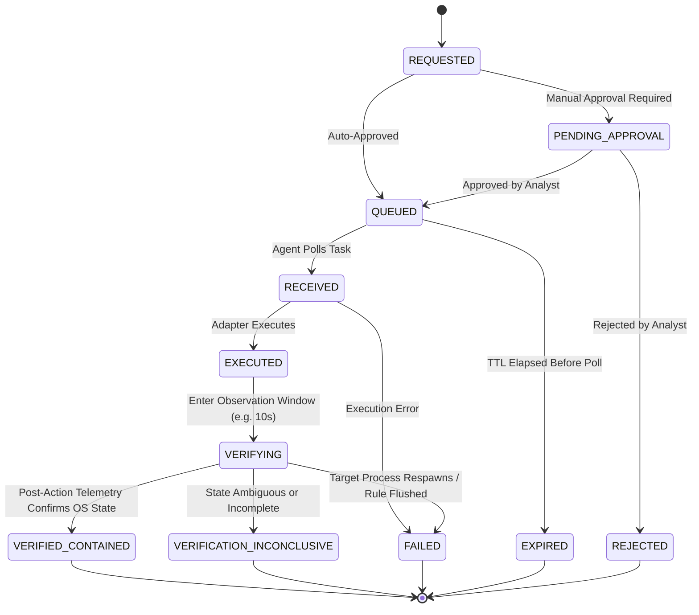

# Platform Security Model & Cryptographic Specifications
**Project:** Ethio-SOAR (Waliya-IR)
**Status:** Locked / Approved (Phase 1 — Step 2)

---

## 1. Threat Model & Security Principles

Waliya-IR operates under zero-trust assumptions regarding the endpoint network environment:

1. **Inbound Port Elimination:** Monitored endpoints NEVER expose open listening management ports (SSH, HTTP/gRPC daemons). All C2 traffic is outbound HTTPS initiated by the agent.
2. **Per-Agent Cryptographic Isolation:** Every agent possesses a unique 256-bit cryptographic secret (`agent_secret`). Compromise of an individual endpoint does not grant the adversary the ability to forge commands for other fleet endpoints.
3. **Deterministic Canonical Signing:** All command payloads dispatched from the SOAR server are signed using HMAC-SHA256 over a deterministic, canonical JSON representation of the command fields.
4. **Replay & Expiry Defenses:** Commands include a UUIDv4 nonce, monotonic sequence number, and short time-to-live (`expires_at`, max 60s). Replayed or stale commands are discarded.
5. **Strictly Allowlisted Adapters:** Agents do not accept or execute arbitrary shell commands. Response actions are limited to statically defined, compiled adapters.
6. **Tamper-Evident Ledger:** Audit records are linked via SHA-256 hash chaining to detect any retroactive modification or deletion.

---

## 2. Secure Agent Command Protocol

### 2.1 Canonical Serialization Specification
To prevent signature mismatch or canonicalization attacks across different JSON implementations, the payload string $P$ for HMAC signing is strictly serialized using:
- UTF-8 encoding.
- Sorted keys (`sort_keys=True`).
- Compact separators (`separators=(',', ':')` with zero whitespace).
- Canonical ISO 8601 UTC timestamps (ending in `Z` or `+00:00`).

The canonical message string is assembled from the exact security-critical fields:
$$M = \text{command\_id} \,\|\, \text{agent\_id} \,\|\, \text{action} \,\|\, \text{canonical\_params\_json} \,\|\, \text{sequence} \,\|\, \text{nonce} \,\|\, \text{issued\_at} \,\|\, \text{expires\_at}$$

### 2.2 HMAC-SHA256 Signature Generation & Verification
The SOAR server computes:
$$\text{Signature} = \text{HMAC-SHA256}(\text{key} = \text{agent\_secret}, \text{msg} = M.\text{encode('utf-8')}).\text{hexdigest()}$$

Upon receiving the task, the agent:
1. Validates that current time $T_{\text{agent}} \le \text{expires\_at}$.
2. Validates that $\text{sequence} > \text{last\_seen\_sequence}$.
3. Validates that $\text{nonce}$ has not been seen within the active sliding cache window.
4. Re-computes the expected HMAC-SHA256 signature using its local secret.
5. Compares signatures using a **constant-time comparison algorithm** (`hmac.compare_digest` in Python / crypto-subtle in other runtimes) to prevent timing side-channel attacks:
   $$\text{Valid} \iff \text{hmac.compare\_digest}(\text{received\_signature}, \text{computed\_signature})$$

### 2.3 Command Action Allowlist
The agent only recognizes the following enumerated actions. Any command specifying an unknown action or unvalidated parameters is rejected with error code `REJECTED_UNKNOWN_ACTION`:

| Action Enum | Allowed Parameters | Verification Check |
| :--- | :--- | :--- |
| `ISOLATE_HOST` | `direction: ["INBOUND", "OUTBOUND", "ALL"]`, `allowed_subnets: list[str]` | Verify iptables/nftables isolation rules active |
| `RESTORE_HOST` | None | Verify firewall default policy and rules flushed |
| `BLOCK_IP` | `ip_address: IPv4/IPv6`, `direction: ["IN", "OUT", "BOTH"]` | Verify IP blocked in firewall filter table |
| `UNBLOCK_IP` | `ip_address: IPv4/IPv6` | Verify IP removed from block table |
| `TERMINATE_PROCESS` | `pid: int`, `process_name: str`, `kill_tree: bool` | Verify PID no longer present in `/proc` |
| `QUARANTINE_FILE` | `path: str`, `quarantine_directory: str` | Verify source path removed and moved to quarantine |
| `COLLECT_FORENSIC_ARTIFACT` | `artifact_type: ["LOGS", "PROC_MAP", "SOCKET_TABLE"]` | Verify archive hash matches submitted manifest |

---

## 3. Two-Stage Closed-Loop Containment Verification

The platform rejects the "false containment fallacy". A successful command receipt simply proves the action was initiated; it does not prove containment.

---

## 4. Tamper-Evident SHA-256 Audit Ledger

Every sensitive system operation (rule change, user login, playbook execution, incident status update) generates an immutable audit record:

1. **Genesis Record:** Record 0 has $\text{prev\_hash} = \text{"0" * 64}$.
2. **Chaining Formula:**
   $$\text{RecordHash}_n = \text{SHA-256}\Big(\text{RecordHash}_{n-1} \,\|\, \text{record\_id} \,\|\, \text{timestamp} \,\|\, \text{actor\_id} \,\|\, \text{action} \,\|\, \text{canonical\_payload}\Big)$$
3. **Concurrency Serialization:** Database transactions appending to the audit ledger acquire an exclusive table-level advisory lock (`pg_advisory_xact_lock`) ensuring deterministic sequence numbering and preventing ledger forks.
4. **Verification Endpoint:** `GET /api/v1/audit/verify` re-computes every hash from Genesis to current record $N$. If any $\text{RecordHash}_k \neq \text{expected}$, the exact compromised record index and timestamp are surfaced.

---

## 5. Simulation Isolation & Defense-in-Depth Model

To prevent purple-team simulations and automated detection validation from interfering with real security operations or causing accidental operational outages, the platform enforces strict defense-in-depth isolation invariants:

### 5.1 Storage Layer Partitioning
- All simulated detections and correlated incidents are explicitly tagged in PostgreSQL with `is_simulation = True` and indexed `simulation_run_id`.
- The incident correlation engine strictly enforces:
  - Synthetic findings from run $A$ never correlate with findings from run $B$.
  - Synthetic findings never merge into real production incidents.
  - Real findings never merge into simulation incidents or inherit `[SIMULATION]` prefixes.

### 5.2 Redis In-Memory State Isolation
- Sliding-window threshold evaluation keys are namespaced: `waliya:win:sim:{run_id}:{rule_id}:{entity}`.
- Alert deduplication suppression keys are namespaced: `sim:{run_id}:{rule_id}:{entity}`.
- Telemetry consumer worker prevents synthetic events from training or polluting production EWMA behavioral baselines.

### 5.3 Mandatory Playbook Containment Guard
- The SOAR response engine enforces that any playbook executed against an incident with `is_simulation = True` has `dry_run = True` hard-coded and non-negotiable.
- Real endpoint response commands (iptables drops, process termination) are cryptographically and logically prohibited for simulated incidents.

### 5.4 Safe Entity Namespaces
- Telemetry generators strictly use RFC 5737 reserved test subnets (`198.51.100.0/24`, `203.0.113.0/24`) and synthetic host/user identifiers (`sim-sensor-`, `sim-admin-`). Real production subnets or hostnames cannot be targeted.

---

## 6. Threat Intelligence & Asset Criticality Boundaries

The threat intelligence and asset context subsystem enforces strict operational boundaries to prevent security degradation, reconnaissance hazards, or false confidence:

### 6.1 Strict 100% Offline Observable Matching
- **Zero Active Probing:** The matching service (`ThreatIntelMatcher`) operates entirely against internal PostgreSQL indexed stores. It NEVER executes DNS requests, HTTP requests, ping sweeps, or TCP socket connections to observed IP addresses, domains, or URLs.
- **Foreign/Unfamiliar IP Policy:** An IP address or domain is NEVER classified as malicious simply because it is foreign, unusual, or external to the corporate network. Malicious attribution strictly requires an explicit indicator record with active status and positive confidence score.

### 6.2 Administrative Asset Authority Invariant
- **No Agent Self-Criticality:** Business criticality (`CRITICAL`, `HIGH`, `MEDIUM`, `LOW`) is strictly an administrative prerogative. Monitored endpoint sensors cannot assign or escalate their own business criticality in telemetry or heartbeat payloads.
- **Explicit Unassigned State:** Endpoints without explicit administrative context are categorized as `UNASSIGNED` with $+0.0$ risk weight. They are never implicitly or silently defaulted to `LOW`.
- **Immutable Context Auditing:** Every creation, modification, or reassignment of an asset's criticality is signed and committed to the SHA-256 hash-chained `audit_ledger`.

### 6.3 Bounded Risk Elevation & Resilience
- **Alert Flooding Protection:** Multi-feed indicator overlaps and repeated hits on an observable cannot inflate incident risk indefinitely; threat intelligence contributions are mathematically clamped to a maximum $+15.0$ bonus:
  $$\text{Bonus}_{\text{TI}} = \min(15.0,\, \max(\text{confidence}) \times 0.15)$$
- **Non-Blocking Resilience:** A temporary unavailability of asset metadata or threat intel records degrades gracefully to default risk weights and NEVER blocks event normalization, rule evaluation, or finding generation.

### 6.4 Threat Intelligence Feed Ingestion & Transport Security
- **100% Read-Only External Access:** Feed connectors (`ThreatFox`, `URLhaus`) only perform outbound HTTPS requests to retrieve indicator catalogs. The platform NEVER submits, uploads, or leaks internal customer observables or incident details to external providers.
- **No Active Probing or Binary Execution:** The platform NEVER probes, scans, or connects to external observables discovered in feeds, and strictly avoids downloading or executing binary malware samples.
- **Strict TLS & Official Host Allowlisting:** Connectors strictly mandate TLS certificate verification and validate target hostnames against official provider allowlists (`threatfox-api.abuse.ch`, `urlhaus-api.abuse.ch`). Insecure TLS bypasses are prohibited.
- **Manual Redirect Inspection:** Automatic HTTP redirect following is disabled; redirects are explicitly inspected against host allowlists and HTTPS schemes to eliminate SSRF hazards and credential leakage.
- **Credential Protection:** External API keys are injected exclusively via runtime environment variables (`WALIYA_TI_THREATFOX_API_KEY`, `WALIYA_TI_URLHAUS_API_KEY`) and are redacted from all operational logs and error diagnostics.
- **Resource Ceilings & Bounded Retries:** Feed payloads are constrained to a 10MB maximum ceiling (`TI_MAX_RESPONSE_SIZE_BYTES`) with strict 15-second timeouts and bounded exponential backoff.
- **Multi-Source Provenance Isolation:** Indicators from distinct providers are isolated through the composite unique constraint `(indicator_type, value, source)`. Synchronizations cannot silently overwrite or degrade indicators originating from other feeds or manual analyst curation.
- **Audit Ledger Tracking:** All synchronization runs, dry-runs, and administrative feed configuration adjustments are cryptographically chained and recorded in the SHA-256 tamper-evident `audit_ledger`.

### 6.5 Indicator Lifecycle Management, Deterministic Decay & Audit Integrity
- **Role-Based Authorization:** All indicator lifecycle mutations (activation, deactivation, expiration, extension of expiry, confidence decay execution) strictly mandate `ADMIN` role authentication. Read-only analysts cannot modify indicator operational states.
- **Prohibition of Silent Reactivation:** Activating an indicator via `POST /threat-intel/indicators/{id}/activate` verifies whether `expires_at` is in the past. If the indicator is already expired, reactivation is rejected with HTTP 400 Bad Request. Operators must explicitly invoke the extend-expiry endpoint (`POST /threat-intel/indicators/{id}/extend-expiry`) to set a future expiration date before reactivation is allowed.
- **Loopback and Private Non-Routable Filtering:** `ThreatIntelMatcher` strictly suppresses lookups for local loopback and unspecified addresses (`127.0.0.1`, `::1`, `localhost`, `0.0.0.0`). This eliminates false positive alerts and self-containment loops against local system interfaces.
- **Deterministic and Idempotent Confidence Decay:**
  - Confidence decay executes via `ThreatIntelDecayService` with strict idempotency tracked through `last_decayed_at`.
  - Repeated executions within the same interval apply zero changes to indicator scores.
  - Hard floor enforcement (`min_confidence`, default $\ge 10$) prevents confidence from decaying into negative integers or reaching zero.
  - Dry-run capability allows previewing decayed candidates and score changes prior to persisting mutations.
- **Tamper-Evident SHA-256 Audit Trail:** Every lifecycle mutation generates an immutable, chained audit entry in `audit_ledger`:
  - `INDICATOR_ACTIVATED`, `INDICATOR_DEACTIVATED`, `INDICATOR_EXPIRED`, `INDICATOR_EXPIRY_EXTENDED`, `THREAT_INTEL_DECAY_RUN`.
- **Simulation Isolation Guarantees:** Telemetry containing simulated threat observables retains `is_simulation = True`. Detections originating from simulated observables strictly produce simulated findings and simulated incidents, and can never trigger real containment commands or distort production baseline metrics.

---

## 7. Response Plan Governance, Approval Gates & Execution Integrity

To prevent accidental outages, insider threat abuse, or unauthorized remediation actions, Waliya-IR implements a multi-tier governance model for response plans (`ResponsePlanService`):

### 7.1 Authoritative Allowlisted Action Registry
- Only 7 strictly allowlisted response operations are accepted:
  - `COLLECT_FORENSIC_ARTIFACT` (READ_ONLY, risk level 1)
  - `BLOCK_IP` (REVERSIBLE, risk level 2)
  - `UNBLOCK_IP` (REVERSIBLE, risk level 2)
  - `RESTORE_HOST` (REVERSIBLE, risk level 2)
  - `ISOLATE_HOST` (CONTAINMENT, risk level 3)
  - `TERMINATE_PROCESS` (DESTRUCTIVE, risk level 4)
  - `QUARANTINE_FILE` (DESTRUCTIVE, risk level 4)
- **Zero Arbitrary Execution:** Custom scripts, interactive shell commands, and untyped external binaries are categorically rejected by the `ActionParametersValidator` schema.
- **Safety Invariants:**
  - `BLOCK_IP`: Prohibits blocking RFC 1122 loopback (`127.0.0.0/8`), RFC 3927 link-local (`169.254.0.0/16`), multicast (`224.0.0.0/4`), or broadcast (`255.255.255.255`) addresses.
  - `TERMINATE_PROCESS`: Strictly forbids terminating PID 1 (`init`/`systemd`) or system management daemons.

### 7.2 Finite State Machine & Illegal Transition Prevention
- Response plans transition strictly through a formal finite state machine:
  - `DRAFT` $\to$ `PENDING_APPROVAL` or `CANCELLED`
  - `PENDING_APPROVAL` $\to$ `APPROVED`, `REJECTED`, or `CANCELLED`
  - `APPROVED` $\to$ `EXECUTING` or `CANCELLED`
  - `EXECUTING` $\to$ `SUCCEEDED` or `FAILED`
- Terminal states (`SUCCEEDED`, `FAILED`, `REJECTED`, `CANCELLED`) cannot transition to any other state.
- Bypassing approval gates (e.g. attempting to execute directly from `DRAFT` or `PENDING_APPROVAL`) raises `InvalidLifecycleTransitionError` and results in HTTP 400 Bad Request.

### 7.3 Cryptographic Approval Hash (`approval_hash`)
- Upon plan submission or authorization, a canonical SHA-256 digest of the complete action sequence is computed:
  $$\text{ApprovalHash} = \text{SHA-256}\Big(\text{CanonicalJSON}(\text{actions})\Big)$$
- Prior to dispatching signed agent commands in `execute_plan`, the service recomputes the canonical hash. Any modification to parameters, target agents, or command sequence between authorization and execution triggers immediate abort with `ValueError`.

### 7.4 Separation-of-Duties & Administrative Audit Trail
- Plans record `created_by`, `approved_by`, `rejected_by`, and `cancelled_by` with timestamps and mandatory justification text.
- The system explicitly records whether separation-of-duties was honored (`created_by != approved_by`) in the SHA-256 tamper-evident `audit_ledger`.
- In single-administrator environments, this constraint is documented transparently rather than fabricating independent duty separation.

### 7.5 Simulation Isolation & Forced Dry-Run
- Any plan linked to an incident marked as a synthetic simulation (`is_simulation = True` or `[SIMULATION]` title prefix) is forcibly constrained to `dry_run = True`.
- Attempts by analysts or API payloads to override `dry_run = False` on simulation plans are overridden to `dry_run = True` with a logged safety warning, guaranteeing that purple-team testing never isolates live management planes or kills production processes.

### 7.6 Idempotency Protection
- Client-provided `idempotency_key` tokens prevent duplicate executions resulting from network retries. If an execution request is replayed with a matching key on an active or completed plan, the existing receipt is returned without generating duplicate command envelopes or re-triggering endpoint operations.

### 7.7 Reliable Execution Engine & Adapter Security
- **Strict Row-Level Locking:** Plan execution acquires `with_for_update()` row-level locks on `ResponsePlanModel` in PostgreSQL, preventing concurrency races where two workers or duplicate API requests attempt simultaneous dispatch.
- **Fail-Closed Target Agent Verification:** In production execution mode, the engine verifies that the destination agent is ONLINE. If an agent is in REVOKED or OFFLINE status, production execution fails closed immediately.
- **Interrupted Execution Reconciliation:** In-flight executions halted by system restarts or infrastructure timeouts can be reconciled via `/plans/{plan_id}/reconcile`, which labels unconfirmed actions as `OUTCOME_UNCERTAIN` and persists a tamper-evident audit record without altering historical command logs.
- **Bounded Execution Timeouts:** Each individual action step execution is bounded by `asyncio.wait_for(...)` derived from the registered `default_timeout_seconds`.
- **Suppression of Retries for Destructive Actions:** In accordance with distributed safety principles, actions classified as `DESTRUCTIVE` (`TERMINATE_PROCESS`, `QUARANTINE_FILE`) or actions that time out (`TIMED_OUT`) are strictly never automatically retried. Timeouts indicate an uncertain outcome where the command may have already begun execution on the host; retrying could cause unintended compounding side effects.
- **Durable Audit & Leak Prevention:** Audit ledger records capture full execution diagnostics while explicitly sanitizing credentials, agent token peppers, and symmetric secrets.

## 7. Entity Correlation & Bounded Attack Graph Security

The entity correlation and attack graph engine enforces strict defense-in-depth boundaries to guarantee evidence integrity, resource protection, and access control:

### 7.1 Zero-Invention & Evidence Traceability Invariants
- **Evidence-Backed Relationships Only:** Graph edges are created solely when substantiated by actual event telemetry or stored findings. Every edge explicitly persists the originating `evidence_event_ids`, timestamp, and source provenance tag.
- **Uncertainty Demarcation:** Speculative, inferred, or foreign connections are never represented as confirmed edges. Edge confidences are mathematically calibrated based on telemetry verification (e.g. 1.0 for confirmed SSH success, 0.7 for failed attempts).
- **Loopback and Non-Routable Suppression:** Local loopback (`127.0.0.1`, `::1`, `localhost`), unspecified (`0.0.0.0`), and placeholder identities are filtered out during entity extraction to eliminate self-containment loops and spurious internal noise.

### 7.2 Denial-of-Service & Combinatorial Explosion Defenses
- **Strict Traversal Depth Bounds:** Directed path queries enforce mandatory depth cutoffs (`max_depth: 1..6`, default 4) and path count ceilings (`max_paths: 1..20`, default 10). Arbitrary or unbound traversal queries are rejected at the API boundary with HTTP 422.
- **Cycle-Safe Traversal:** Graph traversal relies on simple-path algorithms with visited node tracking to ensure cyclic structures (e.g. lateral movement loops) terminate deterministically without recursion exhaustion.
- **Memory & Resource Caps:** The global in-memory graph enforces strict node (`DEFAULT_MAX_NODES = 5000`) and edge (`DEFAULT_MAX_EDGES = 25000`) ceilings with sliding-window TTL pruning (60 minutes). When limits are exceeded, degree-0 orphan nodes are purged first, followed by LRU eviction.

### 7.3 Authorization, Auditability, and Simulation Isolation
- **Role-Based Protection:** All correlation graph endpoints (`/correlation/graph`, `/correlation/attack-paths`, `/correlation/paths`, `/correlation/entities/*`) and incident graph refresh operations (`/incidents/{id}/graph/refresh`) strictly mandate administrative authentication (`X-Admin-Key` or Bearer token).
- **Incident Graph Rebuild Provenance:** Graph refreshes write audit entries (`GRAPH_REBUILT`) to `incident.update_history`, tracking node, edge, and attack path counts.
- **Simulation Isolation:** Attack graphs generated for simulated incidents (`is_simulation = True`) strictly correlate only with entities belonging to that specific simulation run. Simulated attack paths never leak into production incident graphs or trigger automated containment.

### 7.4 Evidence-Backed MITRE ATT&CK Mapping & Investigation Integrity
- **Three-State Classification Model:** To avoid deceptive over-confidence and maintain strict evidentiary standards, the platform classifies all alerts into three explicit states:
  1. `MAPPED`: Backed by stored, verified sensor event records (`evidence_event_ids`) and explicit technique tags.
  2. `UNMAPPED`: Triggered by behavioral anomaly (EWMA) or heuristic rules without technique tags; preserved as unmapped without speculative categorization.
  3. `INSUFFICIENT_EVIDENCE`: Technique referenced in metadata or threat feed, but zero underlying event records exist in the incident repository.
- **Zero-Hallucination & Offline Integrity:** Technique lookups operate strictly against the embedded, authoritative local catalog (`v15.1` in `waliya.detection.mitre_catalog`). No stochastic LLMs, runtime web requests, or external heuristic approximations are utilized.
- **No Side-Effect Risk Escalation:** MITRE coverage mappings are purely investigative and observability metadata. Mapping an alert to a technique NEVER modifies an incident's composite risk score or automatically triggers SOAR response actions.
- **Boundary Disclosures & Analyst Transparency:** The platform surfaces mandatory limitations disclosing that technique mappings represent detected, evidence-backed events only and do not establish confirmed chronological or causal attack sequence.

### 7.5 Incident Reconstruction Security, Evidence Integrity & Non-Interference
- **Strict Non-Interference Guarantees:**
  - Generating an incident reconstruction is a strictly read-only, non-mutating operation.
  - It does not modify original telemetry events, rewrite findings, alter threat indicator confidence scores, reactivate expired indicators, adjust incident risk scores, or trigger automated response actions.
- **Authorization & Data Scope Boundaries:**
  - The endpoint `GET /api/v1/incidents/{incident_id}/reconstruction` enforces administrative authentication (`verify_admin_key`).
  - Evidence queries are strictly parameterized and scoped to the requested incident. An evidence ID cannot be used across boundary lines to access unrelated incident records.
- **Simulation Isolation Enforcement:**
  - Reconstructions enforce strict boundary checks (Check 10 in `IncidentConsistencyValidator`). If an incident is marked `is_simulation = False`, simulated findings (`is_simulation = True`) are rejected as boundary violations.
  - Simulated incidents remain completely partitioned within their designated `simulation_run_id`.
- **Timestamp Integrity & Non-Fabrication:**
  - The reconstruction pipeline strictly forbids timestamp fabrication or estimation. Observations without valid timestamps are reported with explicit data gap tags rather than interpolated times.
- **Prevention of False Causality:**
  - The API contract and frontend workspace enforce strict visual and structural demarcation between observed chronological arrival order and graph-discovered attack paths.
  - Candidate attack progressions carry mandatory disclaimer metadata emphasizing that graph reachability does not prove a single causal execution chain.

## 8. Outbound Integration Security, SSRF Prevention & Notification Governance

Phase 10 Prompt 1 establishes secure, reliable, and auditable outbound notification capabilities governed by strict perimeter security controls:

### 8.1 SSRF & Outbound Egress Prevention
- **Two-Stage URL Validation:** Outbound URLs are strictly validated upon configuration (`POST /integrations/destinations`, `PATCH /integrations/destinations/{id}`) and validated a second time immediately prior to socket connection in `NotificationDeliveryService`.
- **Prohibited Address Defense:** Destination hostnames are resolved via `socket.getaddrinfo()`. All candidate IP addresses are parsed with Python's `ipaddress` library and evaluated against prohibited ranges. Any target matching the following is immediately blocked:
  - Loopback (`127.0.0.0/8`, `::1`)
  - Private networks (`10.0.0.0/8`, `172.16.0.0/12`, `192.168.0.0/16`, `fc00::/7`)
  - Link-Local subnets (`169.254.0.0/16`, `fe80::/10`)
  - Cloud metadata service endpoints (`169.254.169.254`, `fd00:ec2::254`, `metadata.google.internal`) unconditionally blocked
  - Multicast, broadcast, reserved, and unspecified address spaces.
- **Unvalidated Redirect Suppression:** Safe HTTP clients are instantiated with `follow_redirects=False`. If an external receiver returns a 3xx redirect response, the redirect is not followed, neutralizing open redirect SSRF attacks.
- **Bounded Request Limits:** Connect timeouts (5s), read timeouts (10s), and max response body consumption (16 KB) prevent socket exhaustion and remote denial-of-service attempts.

### 8.2 Request Signing & Secret Protection
- **Secret Encryption at Rest:** Webhook HMAC signing secrets are encrypted with Fernet symmetric encryption using the master platform key (`settings.SECRET_KEY`).
- **Secret Disclosure Prevention:** Signing secrets are strictly excluded from API list/detail responses, database logs, delivery audit payloads, and error diagnostics.
- **Deterministic HMAC-SHA256 Signing:** Outbound notifications include the header `X-Waliya-Signature` containing the hex digest of the HMAC-SHA256 calculated over the exact canonical UTF-8 JSON bytes transmitted. Constant-time verification (`hmac.compare_digest`) protects against timing attacks.

### 8.3 Data Minimization & Payload Governance
- **Strict Data Redaction:** Outbound JSON contracts (`NotificationPayload`) exclude raw telemetry events, unredacted memory strings, agent tokens, master keys, and authorization headers.
- **Delivery Idempotency:** Every delivery record includes a unique, immutable `delivery_id` UUID transmitted via `X-Waliya-Delivery-Id`. Receivers can use this identifier for safe deduplication across retries.

### 8.4 Notification Loop Suppression
- **Zero Self-Amplifying Loops:** Failures during webhook delivery are logged and recorded in delivery telemetry, but NEVER emit new security incidents or findings.
- **Internal Bookkeeping Isolation:** Administrative status transitions and delivery retries are excluded from external notification subscriptions.

---

## 9. Inbound External Security Event Ingestion & Threat Boundary Governance

Phase 10 Prompt 2 establishes secure, authenticated, and bounded ingestion of security telemetry from explicitly authorized external systems (EDR, SIEM, cloud posture engines):

### 9.1 Boundary Authentication & Replay Attack Defense
- **Explicit Source Registry:** External events are only accepted from explicitly provisioned records in `InboundSourceModel`. Unregistered or disabled sources are rejected at the edge.
- **HMAC-SHA256 Payload Signature Verification:**
  - Inbound webhook deliveries authenticate via `X-Waliya-Signature` (or `X-Signature`).
  - Signature is computed as `hmac.new(shared_secret, raw_body_bytes, sha256).hexdigest()`.
  - Verification uses constant-time comparison (`hmac.compare_digest`) to neutralize timing side-channel attacks.
  - Secret keys are encrypted at rest with Fernet and never disclosed in API responses or logs (`has_shared_secret: True`).
- **Cryptographic Timestamp Freshness Window:**
  - Callers must provide an ISO 8601 or UNIX epoch timestamp in `X-Waliya-Timestamp` (or `X-Timestamp`).
  - The server verifies $|T_{\text{server}} - T_{\text{request}}| \le 300\text{ seconds}$ ($\pm 5$ minutes).
  - Stale or clock-skewed requests are rejected immediately with `401 UNAUTHORIZED`, defeating replay attacks.

### 9.2 Attack Surface Minimization & Payload Hardening
- **Bounded Ingress Sizing:** Inbound request body is strictly capped at 1 MB (`1,048,576` bytes) to prevent memory exhaustion attacks.
- **Recursion Depth Ceiling:** JSON structure depth is bounded at 5 levels (`MAX_NESTING_DEPTH = 5`) to defend against deeply nested stack-overflow attacks.
- **Command Injection Key Prohibition:**
  - Inbound payloads are scanned for disallowed command-execution keys (`__exec__`, `shell_cmd`, `eval`, `raw_command`, `system_exec`, `bash_c`, `cmd_exec`, `__import__`).
  - Payloads containing any prohibited key are rejected with `400 BAD REQUEST`.
- **Platform Reserved Key Prohibition:**
  - Payloads cannot inject internal system control fields (`approval_hash`, `agent_token`, `enrollment_token`, `auth_hash`, `private_key`).

### 9.3 Agent Impersonation Shield & Provenance Integrity
- **No Agent Impersonation:** Inbound external events are explicitly assigned `agent_id = None` and `source = "external:<source_id>"`. External providers cannot forge internal agent identities or claim enrollment status.
- **Strict Provenance Tagging:** Normalized envelopes are stamped with `is_external = True`, `is_simulation = False`, and `provenance = "EXTERNAL"`.
- **Defensive Severity Fallbacks:** External severity scores (text or numeric) are defensively mapped into the platform's standard severity enum (`CRITICAL`, `HIGH`, `MEDIUM`, `LOW`, `INFORMATIONAL`), defaulting safely to `MEDIUM` on unrecognized values.

### 9.4 Persistent Deduplication & Concurrent Race Safety
- **Durable Deduplication Scope:** Deduplication is tracked in `InboundEventDedupModel` backed by a compound unique constraint `(source_id, external_event_id)`.
- **Cross-Source Isolation:** Distinct external sources submitting identical external event IDs are isolated and do not collide.
- **Race Condition Handling:** Concurrent submissions of duplicate events are safely handled via database uniqueness constraint rollback, returning an idempotent `202 ACCEPTED` with `status = "DUPLICATE"` and the existing internal event ID.

### 9.5 Strict Response Safety & Containment Isolation
- **Non-Execution Invariant:** Inbound external events flow exclusively through standard detection and correlation pipelines (`stream:telemetry:raw` -> `TelemetryConsumerWorker`).
- **Zero Automatic Containment:** Under no circumstances can an external event directly trigger response plans, invoke containment adapters (e.g. `ISOLATE_HOST`, `TERMINATE_PROCESS`), or bypass Phase 9 approval gates.

---

## 10. End-to-End Interoperability, Trust Boundaries & Closed-Loop Safety

Phase 10 Prompt 3 establishes and independently verifies the interoperability between outbound security notifications and authenticated inbound external event ingestion:

### 10.1 Compatibility & Signature Contract
The following interoperability specification governs both outbound webhook transmission and inbound event ingestion:

| Specification Attribute | Contract Definition |
| :--- | :--- |
| **Signature Algorithm** | HMAC-SHA256 (`hashlib.sha256`) |
| **Transmission Format** | Hexadecimal digest (supports bare `<hex>` or `sha256=<hex>`) |
| **Verification Method** | Constant-time comparison via `hmac.compare_digest` |
| **Freshness Window** | Maximum 300 seconds ($\pm 5$ minutes) clock drift against UTC |
| **Outbound Delivery Headers** | `X-Waliya-Delivery-Id`, `X-Waliya-Event-Type`, `X-Waliya-Timestamp`, `X-Waliya-Signature` |
| **Inbound Webhook Headers** | `X-Waliya-Source-Id`, `X-Waliya-Timestamp`, `X-Waliya-Signature` |
| **Payload Schema Version** | Version `1.0` (`NotificationPayload`) |
| **Receiver Deduplication** | Stable UUIDv4 `delivery_id` transmitted in headers and payload |
| **Duplicate Delivery Behavior** | Receiver should idempotently acknowledge re-transmissions using `delivery_id` |

### 10.2 End-to-End Trust Boundaries
1. **Inbound Trust Boundary:**
   - External callers are untrusted by default.
   - External identity claims (e.g. `agent_id` or `hostname`) are discarded; `agent_id` is set strictly to `None` and `source` is set to `f"external:{source_id}"`.
   - Payload scanner rejects command keys (`__exec__`, `eval`, `shell_cmd`, etc.) and internal system keys (`approval_hash`, `agent_token`, etc.).
   - Nested structures beyond 5 levels or payloads exceeding 1 MB are dropped at the edge.
2. **Outbound Trust Boundary:**
   - Outbound destinations are strictly restricted to administratively authorized targets (`NotificationDestinationModel`).
   - Two-stage SSRF validation verifies URL schemes (`https`), rejects embedded credentials, and resolves DNS to block loopback (`127.0.0.0/8`, `::1`), private RFC 1918 subnets, link-local addresses, and cloud metadata services (`169.254.169.254`, `fd00:ec2::254`).
   - HTTP redirects are disabled (`follow_redirects=False`) to defeat open redirect SSRF bypasses.
   - Outbound payloads are minimized: zero secrets, zero platform credentials, zero raw telemetry dumps, and zero internal stack traces.
3. **Cross-Subsystem Non-Interference:**
   - Inbound source secrets are isolated from outbound destination APIs and vice versa.
   - Outbound notification failures and retries NEVER generate internal findings, incidents, or outbound notifications (loop suppression).
   - Inbound events NEVER trigger response plans or containment adapters.
   - Production and purple-team simulation incidents remain strictly partitioned (`is_simulation` flag).

---

## 11. Production Observability, Diagnostics & Health Monitoring Security (Phase 11 Prompt 1)

Phase 11 Prompt 1 hardens platform observability by separating unauthenticated container orchestration health checks from privileged operational diagnostics, redacting sensitive parameters, and enforcing non-invasive monitoring invariants.

### 11.1 Probing & Information Disclosure Defense
1. **Public Liveness Probes (`/health/liveness`):**
   - Evaluates process responsiveness only.
   - Performs zero database queries, Redis requests, or external calls.
   - Exposes zero system configuration, environment variables, internal IP addresses, or version details beyond static platform version.
2. **Public Readiness Probes (`/health/readiness`):**
   - Probes basic connectivity to PostgreSQL and Redis.
   - Returns strictly `200 READY` or `503 NOT_READY` with high-level component status (`CONNECTED` / `DISCONNECTED`).
   - Leaks zero connection strings, credentials, pool statistics, or internal network topology.
3. **Privileged Operational Diagnostics (`/health/diagnostics`) & Metrics (`/health/metrics`):**
   - Accessible strictly to authenticated administrators via `verify_admin_key` (`X-Admin-Key` header or HttpOnly signed session cookie).
   - Returns detailed latency measurements, worker heartbeats, consumer lag, and queue backlogs.
   - Error messages and worker diagnostics are sanitized: no database credentials, API keys, webhook signing secrets, or raw payloads are ever serialized.

### 11.2 Sensitive Data Redaction & Correlation Tracking
1. **Correlation ID Integrity:**
   - Inbound `X-Request-ID` or `X-Correlation-ID` headers are validated against an alphanumeric pattern (`^[a-zA-Z0-9_-]{1,64}$`).
   - Malicious headers with spaces, control characters, or script tags are discarded and replaced with server-generated `req_{uuid4().hex[:12]}`.
   - Correlation IDs are propagated asynchronously via Python `ContextVar` and echoed in HTTP response headers.
2. **Log Redaction Filter (`SensitiveDataFilter`):**
   - Intercepts all logging records to scrub authentication credentials, passwords, tokens, API keys, private keys, and Bearer authorization tokens.
   - Operates across formatted message strings, keyword dictionaries, and tuple arguments.

### 11.3 Non-Invasive Monitoring Invariants & Operational Safety
1. **No Autonomous Response or Policy Alteration:**
   - Observability probes and health checks are strictly read-only.
   - A monitoring failure NEVER triggers automated agent containment, host isolation, process termination, or network reconfiguration.
   - A successful health probe NEVER automatically marks an incident resolved, closes findings, or modifies composite risk scores.
2. **Truthful Degradation Reporting:**
   - Missing or unavailable monitoring telemetry explicitly returns `UNKNOWN` or `UNAVAILABLE`.
   - The platform never reports `HEALTHY` merely because a monitoring query returned no data.
3. **Bounded In-Memory Footprint:**
   - Metrics are recorded in-memory with strictly bounded label cardinality (`<METHOD>_<CLASS>`, e.g., `GET_2xx`, `POST_4xx`).
   - Bounded moving average windows prevent unbounded memory growth without introducing external dependencies or monitoring daemons.

---

## 12. Resource Exhaustion Defense & Failure Safety (Phase 11 Prompt 2)

Phase 11 Prompt 2 establishes strict operational boundaries, backpressure mechanisms, and failure resilience across data ingestion, graph reconstruction, and response execution.

### 12.1 Resource Ceilings & Denial-of-Service Defense
1. **Bounded Attack Graph Exploration:**
   - `MAX_GRAPH_NODES = 500` and `MAX_GRAPH_EDGES = 1000` ceilings are enforced by `IncidentGraphService`.
   - Traversal algorithms reject unbounded recursive graph expansion, preventing out-of-memory crashes during multi-stage incident reconstruction.
2. **Bounded Database Queries:**
   - Candidate active incidents evaluated during event correlation are bounded to 100 recent candidates (`.limit(100)`).
   - Forensic evidence and chronological timeline queries are capped at 500 records (`.limit(500)`).
3. **In-Memory Rule Caching with Safe Session Detachment:**
   - Detection rules are cached in worker memory for 60 seconds (`time.monotonic()` TTL) with session-detached objects (`make_transient`), preventing redundant SQL scans while guaranteeing immunity from SQLAlchemy detached-instance attribute refresh errors.

### 12.2 Poison-Pill Isolation & Consumer Head-of-Line Blocking Prevention
1. **Batched Pending Message Inspection:**
   - Telemetry consumer queries the Redis Stream Pending Entries List (PEL) using a single `xpending_range` batch per read cycle, eliminating $O(N)$ network roundtrips.
2. **Dead Letter Queue (DLQ) Routing:**
   - Messages exceeding `MAX_DELIVERIES=5` are isolated into `stream:telemetry:dlq` with detailed diagnostic metadata (`original_id`, `delivery_count`, `error="MAX_DELIVERIES_EXCEEDED"`).
   - The poison message is immediately acknowledged in the source stream, preventing consumer crash loops or head-of-line blocking.
3. **Abandoned Message Reclaim Scheduling:**
   - Reclaiming abandoned consumer messages occurs every 30 seconds rather than on every polling tick, preventing PEL contention under sustained high throughput.

### 12.3 Outbound Dispatch Resilience & Non-Idempotent Action Safety
1. **Connection Pool Reuse:**
   - `NotificationDeliveryService.process_pending_deliveries` creates and reuses a single `httpx.AsyncClient` across the delivery batch, eliminating socket churn, file-descriptor exhaustion, and repeated TLS handshakes.
2. **Strict Non-Idempotent Action Retry Invariant:**
   - When an endpoint response action times out or fails with an ambiguous status (`OUTCOME_UNCERTAIN`, `TIMED_OUT`), automated retries are strictly aborted.
   - Destructive actions (`TERMINATE_PROCESS`, `ISOLATE_HOST`) are NEVER automatically re-executed when external outcome is uncertain, protecting production hosts from catastrophic double-execution side effects.
3. **Frontend Polling Backpressure:**
   - UI workspaces enforce an in-flight guard (`isPollingRef`) on periodic data refresh intervals, preventing overlapping poll floods during transient backend latency or high network load.

---

## 13. Adversarial Failure Resilience & Integrity Invariants (Phase 11 Prompt 3)

Phase 11 Prompt 3 verifies through targeted adversarial testing that resilience optimizations do not compromise detection accuracy or response safety:

### 13.1 Zero Event Loss & Poison Message Isolation
1. **Malformed & Poison Message DLQ Routing:**
   - Corrupt, missing ID, non-UUID, or deserialization failures are routed to `stream:telemetry:dlq` and acknowledged to avoid blocking healthy stream processing.
   - Legitimate security events are NEVER dropped or routed to DLQ under valid conditions.
2. **Transactional Rollback Atomicity:**
   - If a database failure occurs during event processing, the consumer worker issues a database rollback and deliberately does NOT acknowledge the message in Redis.
   - The message remains in the Pending Entries List (PEL) for retry or claim by another worker, guaranteeing zero event loss.

### 13.2 Response Execution Safety Under Failure
1. **Never Re-execute Uncertain Actions:**
   - Any response action that was in-flight during a service crash or restart is reconciled to `OUTCOME_UNCERTAIN`.
   - The system NEVER automatically retries or re-executes actions marked `OUTCOME_UNCERTAIN`, requiring human-in-the-loop review to prevent duplicate destructive endpoint effects.
2. **Monitoring Decoupling:**
   - Health probes (`/api/v1/health/*`) and diagnostic queries never trigger response actions, mutate incident states, or alter detection thresholds under any condition.
