# Waliya-Sim: Safe Purple-Team Simulation and Detection Validation

`waliya-sim` is a deterministic, reproducible purple-team CLI validation framework for the Waliya-IR security operations platform. It safely generates synthetic, normalized telemetry scenarios representing adversary techniques and verifies detection pipeline performance end to end without executing real attacks, scanning networks, touching host files, or running privileged commands.

---

## Architecture & Detection Pipeline Validation

`waliya-sim` exercises the **real Waliya-IR production detection pipeline**:

```mermaid
flowchart LR
    A["waliya-sim CLI"] -->|Authenticated Batch<br/>POST /api/v1/telemetry/ingest| B["Telemetry Normalizer & PostgreSQL Ingest"]
    B -->|Transactional Outbox| C["Redis Streams<br/>(stream:telemetry:raw)"]
    C -->|At-Least-Once Consumer| D["TelemetryConsumerWorker"]
    D -->|Evaluate Operators & Windows| E["RuleEngine & EWMA"]
    E -->|Persist Finding| F["PostgreSQL FindingModel"]
    F -->|Correlate Non-Host Entities| G["IncidentCorrelationService"]
    G -->|Persist Correlated Incident| H["PostgreSQL IncidentModel"]
    A -.->|Closed-Loop Verification Polling<br/>GET /api/v1/rules/findings<br/>GET /api/v1/incidents| F
```



1. **Synthetic Telemetry Ingestion**: Submits structured, signed batches to `/api/v1/telemetry/ingest` with `X-Agent-ID` and `Authorization: Bearer <agent_token>`.
2. **Backward-Compatible Simulation Markers**: Every event includes `is_simulation: True`, `simulation_run_id`, and `trace_id` in its payload. Real endpoints are never spoofed; synthetic IP addresses use RFC 5737 `198.51.0.0/16` (`TEST-NET-2`), files use `/var/www/.../sim_*.php`, and users use `sim-*`.
3. **Outbox Dispatch & Stream Consumer**: Events are queued in PostgreSQL's transactional outbox and dispatched to Redis Streams (`stream:telemetry:raw`), where `TelemetryConsumerWorker` processes them asynchronously.
4. **Closed-Loop Verification**: `waliya-sim` polls `/api/v1/rules/findings` and `/api/v1/incidents` to verify detection outcomes, measuring detection latency directly from persisted database timestamps.

---

## Implemented Scenarios & MITRE ATT&CK Mapping

| Scenario ID | Scenario Name | MITRE ATT&CK | Target Rule ID | Telemetry Event Type | Positive Trigger Threshold | Negative Boundary Test (Expected No Detection) |
| :--- | :--- | :--- | :--- | :--- | :--- | :--- |
| `brute-force` | Authentication Brute Force | `T1110.001` | `RULE-AUTH-001-BRUTEFORCE` | `AUTHENTICATION` | $\ge 5$ failures within 300s window | 4 failures (below threshold of 5) |
| `web-shell` | Suspicious Web File | `T1505.003` | `RULE-FIM-004-WEBSHELL` | `FILE_INTEGRITY` | Executable script (.php) created in web root | Benign image file (.png) in web directory |
| `port-scan` | Network Port-Scan Behavior | `T1046` | `RULE-NET-001-PORTSCAN` | `NETWORK_CONNECTION` | $\ge 10$ distinct destination ports in 60s window | 5 distinct destination ports (below threshold of 10) |
| `priv-esc` | Suspicious Privilege Escalation | `T1548.003` | `RULE-PROC-001-PRIVILEGE-ESC` | `PROCESS_EXECUTION` | Non-root user executing privilege binary (`sudo`) | Root user executing privilege binary (`sudo`) |

---

## Installation & CLI Usage

### Installation

From the repository root (inside virtual environment):

```bash
pip install -e sim/
```

Verify installation:

```bash
waliya-sim --help
```

---

### Command Reference

#### 1. List Available Scenarios

```bash
waliya-sim list
waliya-sim list --json
```

#### 2. Preview Scenarios (Side-Effect Free)

Preview inspects generated events without making network calls, creating files, or writing database records:

```bash
# Preview positive detection scenario
waliya-sim preview brute-force

# Preview negative boundary scenario (below threshold)
waliya-sim preview brute-force --negative

# Preview in JSON format
waliya-sim preview web-shell --json
```

#### 3. Run Controlled Simulation

Execute a controlled scenario against a live or test Waliya-IR backend:

```bash
waliya-sim run brute-force \
    --url "http://localhost:8000" \
    --agent-id "<AGENT_UUID>" \
    --agent-token "<AGENT_TOKEN>" \
    --admin-key "<ADMIN_KEY>" \
    --timeout 15.0

# Run negative boundary test (below threshold)
waliya-sim run brute-force --negative \
    --url "http://localhost:8000" \
    --agent-id "<AGENT_UUID>" \
    --agent-token "<AGENT_TOKEN>" \
    --admin-key "<ADMIN_KEY>"
```

Configuration can also be passed via environment variables:

```bash
export WALIYA_URL="http://localhost:8000"
export WALIYA_AGENT_ID="<AGENT_UUID>"
export WALIYA_AGENT_TOKEN="<AGENT_TOKEN>"
export WALIYA_ADMIN_KEY="<ADMIN_KEY>"

waliya-sim run port-scan
waliya-sim run priv-esc
```

**Exit Codes:**
- `0` — `PASS` (positive detection confirmed or negative boundary correctly rejected).
- `1` — `FAIL` (expected detection timed out or negative boundary triggered unexpectedly).
- `2` — `INCONCLUSIVE` / Configuration error (backend unreachable, authentication rejected, or credentials missing).

#### 4. Inspect Completed Run Report

```bash
# View formatted summary card
waliya-sim report sim-a1b2c3d4e5f6

# Output raw structured JSON report
waliya-sim report sim-a1b2c3d4e5f6 --json
```

#### 5. Clean Up Simulation Run Reports

Safely delete local simulation run report files without modifying the production database:

```bash
# Delete single report
waliya-sim clean --run-id sim-a1b2c3d4e5f6

# Delete all simulation report files
waliya-sim clean
```

---

## Detection Latency & Measurement Methodology

Detection latency is measured using actual recorded timestamps:

$$\text{Detection Latency} = t_{\text{finding\_persisted}} - t_{\text{first\_event\_submitted}}$$

- **Timestamp Basis**: Both timestamps are UTC ISO-8601 recorded in the database.
- **Clock Drift Clamping**: If network latency is sub-millisecond or clock jitter yields negative values, latency is clamped to `0.0s`.
- **Measurement Integrity**: If either timestamp cannot be reliably established, the report explicitly states `measurement_established = False` and documents the reason.
- **No Fabricated Benchmarks**: `waliya-sim` reports individual outcomes for specific scenario executions and does not extrapolate false-positive or precision rates from four scenarios.

---

## Safety Guarantees & Operational Invariants

1. **Strictly Non-Destructive**: Never deletes, modifies, or creates host files.
2. **No Real Network Scanning**: Zero packets transmitted to external networks.
3. **No Execution of Elevated Binaries**: No subprocess calls to `sudo`, `iptables`, `kill`, or system shells.
4. **No Automated Containment Triggering**: Simulation events and findings are marked `is_simulation: True` and prefixed `[SIMULATION]`. SOAR response playbooks do not execute destructive actions against test namespaces.
5. **Credential Protection**: Reports and CLI output never print, serialize, or store agent bearer tokens or administrative keys.
